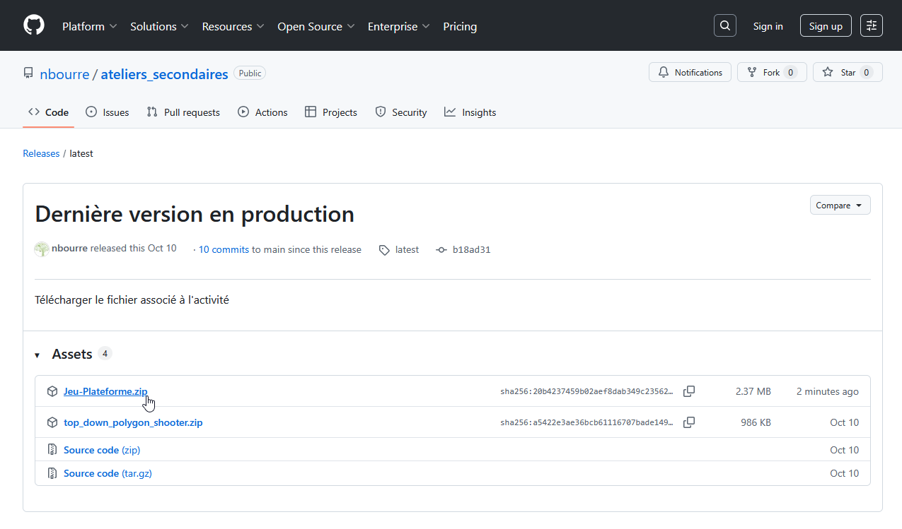
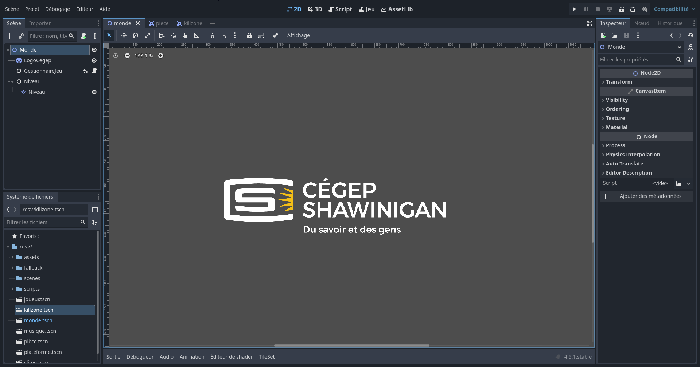
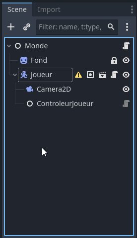
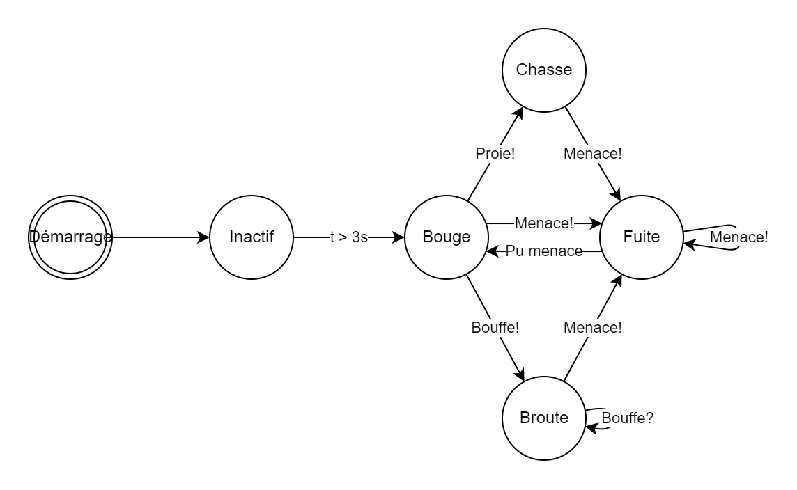
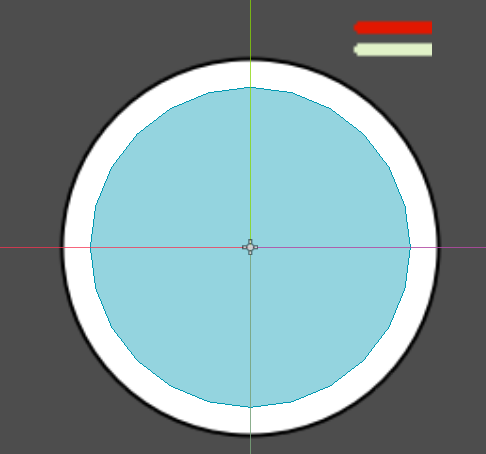

# Atelier numéro 3 : Clonario (clone d'Agar.io)

<video controls src="assets/001_demo.mp4" title="Démonstration de Clonario" autoplay muted loop></video>

## Objectifs
L'objectif de cet atelier est de modifier un projet de base de type « top-down » inspiré du jeu **Agar.io**. Dans ce jeu, tu contrôles une cellule qui grossit en mangeant de la bouffe et des cellules plus petites qu'elle, tout en évitant de se faire manger par les plus grosses.

Étant donné le temps limité, plusieurs éléments sont fournis et préparés d'avance. On va se concentrer sur :

- Placer des scènes dans le monde
- Assigner un contrôleur à une cellule (joueur ou ordinateur)
- Utiliser des générateurs pour remplir le monde
- Ajouter un comportement à l'**intelligence artificielle** des cellules ennemies

---

## Prérequis

- Avoir un navigateur **Edge** ou **Chrome**
    - Pas Firefox, il a un bogue de copier-coller avec Godot Web!
- Télécharger le fichier `Clonario.zip`

!!! note "Dépannage"

    Si ton Godot Web ne semble plus fonctionner ou est instable, va voir la [page de dépannage](../depannage/index.md){target=_blank} pour voir les étapes à suivre pour régler le problème.

---

## Introduction

Faire un jeu vidéo, qu'est-ce qu'il faut?

- Vouloir apprendre
- Être autodidacte
- Modérer ses attentes

Nous allons utiliser un logiciel pour faire des jeux vidéo qui s'appelle **Godot**. Il est gratuit, open source et relativement facile à apprendre pour les débutants.

!!! info "Pourquoi pas Unity ou Unreal Engine?"
    Ces logiciels sont de gros bouffeurs de ressources. Godot fonctionne même directement dans le navigateur, ce qui nous évite toute installation.

Godot est principalement en anglais. En passant, être capable de lire l'anglais de base est super important dans le monde de l'informatique et des sciences!

---

## Étape 1 : Télécharger les ressources

1. Dans ton navigateur, va à l'adresse suivante : [https://tinyurl.com/ateliers-jeux](https://tinyurl.com/ateliers-jeux){target=_blank}
2. Dans la page, il y a un petit tableau. Clique sur le lien `Clonario.zip`.

    

3. Le fichier sera téléchargé et se retrouvera dans ton dossier **Téléchargements**.
    - **Ne l'ouvre pas!** On va le donner directement à Godot.

---

## Étape 2 : Ouvrir Godot

1. Ouvre le navigateur **Edge** ou **Chrome**.
2. Va à la page suivante : [https://tinyurl.com/gd4web](https://tinyurl.com/gd4web){target=_blank}
3. Si une fenêtre surgit avec un texte, clique sur le bouton **Ok, don't show again**.

<video controls src="assets/020_godot_web.mp4" title="Ouvrir Godot Web" autoplay muted loop></video>

!!! tip "Godot installé sur l'ordinateur"
    Si Godot est déjà installé sur ton ordinateur, tu peux l'utiliser à la place de la version web. Il suffit de glisser et déposer le fichier `Clonario.zip` dans la fenêtre des projets.

---

## Étape 3 : Ouvrir le projet

1. Clique sur le bouton **Sélection fichier**.
2. Sélectionne le fichier que tu as téléchargé précédemment.
    - Il y a de bonnes chances qu'il soit dans ton dossier **Téléchargements**.
    - Il devrait se nommer `Clonario.zip`.
3. Clique sur **Ouvrir**.
4. Clique sur **Start Godot Editor**.
    - Cela peut prendre quelques minutes avant d'avoir quelque chose à l'écran.
5. Dans la fenêtre qui apparaît, donne un nom au projet comme « Jeu de cellules ».
6. Clique sur **Installer**. Ça va prendre quelques instants.

!!! warning "Rien ne s'affiche?"
    S'il n'y a rien qui se passe, glisse et dépose le fichier `Clonario.zip` sur la page des projets locaux.

---

## Étape 4 : L'environnement



Tu remarques que c'est probablement un environnement assez différent de ce à quoi tu es habitué. Les développeurs utilisent des logiciels très différents selon l'emploi qu'ils occupent. Ça peut aller du simple éditeur de texte à des environnements complexes de gestion de réseau, en passant par des logiciels spécialisés en programmation. Si tu fais des jeux vidéo plus tard, tu auras sûrement un logiciel semblable.

Ne t'inquiète pas, comme on dit : *tu vas apprendre l'outil sur le tas!*

L'environnement est divisé en plusieurs zones :

1. **Le volet Scène** (en haut à gauche) : affiche les éléments de la scène active.
2. **Le système de fichiers** (en bas à gauche) : affiche les ressources du projet.
3. **La zone de travail** (au centre) : c'est là que tu construis ta scène.
4. **Le bouton Exécuter** (le triangle *Play*, en haut à droite) : permet de tester le jeu.

---

## Étape 5 : Exploration

### La zone de travail

Étant donné que l'on part avec un projet déjà débuté, la première chose à faire est de regarder les ressources que l'on a. Les ressources peuvent être des images, des sons ou des éléments du jeu comme un personnage.

**Ne clique nulle part pour l'instant. Patience!**

On remarque que la zone de travail a un onglet nommé `Monde` (dans la partie du centre, un peu à gauche). Il s'agit de la scène **Monde**.

### Le volet Scène

Dans le volet de gauche, c'est la scène active dans la zone de travail qui est affichée.

!!! note "C'est quoi une scène?"
    Une scène, c'est un peu comme une scène d'une pièce de théâtre. C'est l'assemblage de tous les éléments qui la composent : le personnage, le décor, les ennemis, les PNJ, etc.

    Si l'on « zoome » un peu sur un personnage de jeu, lui-même est une scène, car il est composé de plusieurs éléments tels que son habillage, ses armes, etc.

### Le système de fichiers

Les ressources se retrouvent dans le volet inférieur gauche sous l'onglet **Système de fichiers**. On y voit `res://` et en dessous plusieurs dossiers : `assets`, `fallback`, `scenes` et `scripts`. On va les utiliser en temps et lieu.

- Le fichier `scenes/monde.tscn` représente la scène **Monde** qui est ouverte dans la zone de travail.
    - Pour l'instant il n'y a pas grand-chose, mais on va la remplir plus tard.
- Double-clique sur le fichier `scenes/cellule.tscn`. Ça ouvre la scène de la cellule.
    - Remarque les onglets de la zone de travail : on devrait avoir `Monde` et `Cellule`.
- Si tu cliques sur l'onglet `Monde`, le contenu du volet Scène revient à `Monde`.
- Reviens à la scène de la cellule.

---

## Étape 6 : La cellule

Tu remarques que la scène de la cellule a un contenu différent de la scène du monde. Pour accélérer le développement, j'ai mis en place des **nœuds** dans cette scène.

!!! note "C'est quoi un nœud?"
    Un nœud est un élément de base dans Godot. On utilise le mot « nœud » pour faire une analogie avec un nœud dans un arbre et ses branches. Il peut s'agir d'une image, d'une zone de collision, d'un gestionnaire d'animation, etc.

    Il y a beaucoup de types de nœuds, mais apprendre leur fonctionnement sort de l'objectif de l'atelier. Il faut « speed run » le développement!

### Naviguer dans la zone de travail

- Avec une souris :
    - Fais rouler la molette dans la zone de travail pour agrandir ou réduire la vue.
    - Appuie sur `F` pour centrer la scène.
    - Clique sur la molette et déplace la souris pour déplacer la vue.
- Avec un trackpad :
    - Fais glisser deux doigts sur le trackpad pour te déplacer et agrandir la vue.

### Les nœuds de la cellule

Dans le volet Scène, on retrouve les nœuds qui composent la cellule :

- **Le nœud parent** : devant le nœud, tu remarques l'icône d'un petit personnage. Il s'agit d'un nœud de type `CharacterBody2D` qui permet de gérer la physique du personnage. Ce nœud doit posséder d'autres nœuds pour bien fonctionner.
- **Circle** : contient le cercle qui représente la cellule.
- **Activation** : définit la zone de détection de la cellule.

!!! note "Les animations 2D"
    Les animations dans un jeu vidéo 2D sont réalisées comme dans l'ancien temps : on affiche une séquence d'images, ou on fait des opérations géométriques (comme agrandir un cercle), à grande vitesse pour avoir l'illusion d'un mouvement.

---

## Étape 7 : Mettre la cellule dans le monde

1. Sélectionne l'onglet de la scène `Monde`.
2. Glisse et dépose le fichier `scenes/cellule.tscn` sur le nœud `Monde` dans le volet Scène.
3. La cellule apparaît dans la scène `Monde` à la position (0, 0).
    - Appuie sur `F` pour centrer la vue sur la cellule.
4. **Teste le jeu.** Dans le coin supérieur droit, clique sur le bouton **Play**.

Que se passe-t-il? (1)
{ .annotate }

1.  Pas grand-chose... La cellule est là, mais elle ne bouge pas. Ce n'est pas très excitant, mais on a quelque chose!

- Dans la barre supérieure, clique sur le `X` à côté de **Game** pour revenir au développement.

---

## Étape 8 : Ajouter les contrôles du joueur

Étant donné la complexité du jeu, j'ai déjà programmé les contrôles du joueur. Il faut seulement les brancher.

1. Sélectionne la cellule que tu viens d'ajouter et renomme-la `Joueur`.
2. Ajoute un nœud enfant `Camera2D` au `Joueur`.
    - Rappel : pour ajouter un nœud enfant, clique-droit sur le nœud, sélectionne **Ajouter un nœud enfant...** et recherche le nœud désiré.
3. Ajoute aussi un nœud enfant `ControleurJoueur` au `Joueur`.

Voici à quoi devrait ressembler ta scène :



!!! warning "Le ⚠️ à côté de Joueur"
    C'est normal pour l'instant! La cellule ne sait pas encore quel contrôleur utiliser. On règle ça tout de suite.

4. Sélectionne le nœud `Joueur`.
5. À droite, dans le volet **Inspecteur**, tu devrais voir la propriété `Controleur` avec un bouton **Assigner...**
6. Clique dessus.
7. Dans la nouvelle fenêtre, sélectionne `ControleurJoueur` et clique sur **OK**.

<video controls src="assets/081_assigner_controleur.mp4" title="Assigner le contrôleur" autoplay muted loop></video>

8. **Teste le jeu.** La cellule devrait suivre ta souris.

!!! tip "Les contrôles"
    - **Souris** : la cellule se déplace vers ta souris.
    - **Clic gauche** (ou `F`) maintenu : accélère pour **chasser**.
    - **Clic droit** (ou `G`) maintenu : accélère encore plus pour **fuir**.

    Attention, ces accélérations utilisent de l'énergie. Quand elle est vide, ta cellule ralentit!

<video controls src="assets/082_test_joueur.mp4" title="Tester le joueur" autoplay muted loop></video>

!!! note "Un contrôleur, c'est quoi?"
    La cellule ne décide pas elle-même où elle va. Elle demande à son **contrôleur**. Le `ControleurJoueur` regarde où est ta souris. Plus loin, on va utiliser un `ControleurCellule` qui, lui, prend ses décisions tout seul. La même scène de cellule peut donc être un joueur ou un ennemi, selon le contrôleur qu'on lui donne!

---

## Étape 9 : Ajouter de la bouffe

1. Dans le dossier `scenes`, tu devrais voir `bouffe.tscn`.
2. Glisse cette scène dans la scène `Monde`.
3. **Teste le jeu** et essaie de bouffer le morceau.

Qu'arrive-t-il? (1)
{ .annotate }

1.  La bouffe disparaît et la cellule grossit!

<video controls src="assets/090_bouffe.mp4" title="Manger de la bouffe" autoplay muted loop></video>

4. Glisse 2 ou 3 autres morceaux de bouffe dans le monde.
5. **Teste le jeu.** Ça fonctionne?

### Le générateur de bouffe

C'est bien que ça fonctionne, mais ça deviendrait long d'ajouter tous les morceaux de bouffe à la main. J'ai fait un **générateur** pour en mettre plus.

1. Dans le dossier `scenes`, trouve le fichier `gen_bouffe.tscn`.
2. Glisse-le dans le monde.
3. Assure-toi que le nouveau nœud se nomme exactement `GenerateurBouffe`.
    - Sinon, renomme-le. Le nom est important, car le code le cherche avec ce nom-là!
4. **Teste le jeu.**

<video controls src="assets/091_generateur_bouffe.mp4" title="Générateur de bouffe" autoplay muted loop></video>

---

## Étape 10 : Des cellules ennemies

Que serait un jeu sans un peu de compétition?

À date, nous avons une cellule qui est notre joueur, contrôlée par le `ControleurJoueur`. On peut faire la même chose avec une autre cellule, mais avec un `ControleurCellule`. C'est un script avec une petite **intelligence artificielle** qui décide quoi faire.

<video controls src="assets/100_cellules_ia.mp4" title="Cellules contrôlées par l'IA" autoplay muted loop></video>

### Une cellule ennemie

1. Trouve la scène `cellule.tscn` dans le dossier `scenes` et glisse-la dans le monde.
2. Sélectionne la nouvelle cellule dans le volet Scène.
3. Ajoute-lui un nœud enfant `ControleurCellule`.
4. Resélectionne la cellule dans le volet Scène.
5. Dans l'**Inspecteur**, clique sur **Assigner...** à côté de `Controleur`.
6. Sélectionne `ControleurCellule`.
7. **Teste le jeu.**

### Plusieurs cellules

1. Dans le volet Scène, fais un clic-droit sur la cellule ennemie et sélectionne **Dupliquer**.
2. Fais-le quelques fois et déplace chaque cellule à un endroit différent.
3. **Teste le jeu.**

### Le générateur de cellules

Ça fonctionne, mais comme pour la bouffe, ça serait long de créer toutes les cellules à la main. J'ai programmé un générateur de cellules.

1. Supprime les cellules ennemies que tu as créées.
    - Attention de ne pas supprimer ton `Joueur`!
2. Dans le dossier `scenes`, trouve le fichier `gen_cellule.tscn` et glisse-le sur le `Monde`.
3. Assure-toi que le nouveau nœud se nomme exactement `GenerateurCellule`.
4. **Teste le jeu.**
    - Va bouffer de la nourriture.
    - Quand tu es plus gros, essaie de bouffer des cellules.
    - Observe bien les cellules ennemies.

Que remarques-tu? (1)
{ .annotate }

1.  Les cellules mangent la bouffe et chassent les plus petites, mais elles ne se sauvent pas quand une plus grosse cellule s'approche. Elles s'arrêtent un instant, puis repartent comme si de rien n'était!

---

## Étape 11 : L'intelligence artificielle

Les cellules bouffent la nourriture, mais elles ne semblent pas fuir. Ça serait bien d'ajouter ce comportement!

Le comportement est programmé dans le script `controleur_cellule.gd` qui est dans le dossier `scripts/controleurs`. Double-clique dessus. Tu vas voir plein de code, ne t'en fais pas!

### La machine à états

Une cellule contrôlée par l'ordinateur est toujours dans un seul **état** à la fois. Selon ce qui se passe autour d'elle, elle change d'état. Voici la logique qu'une cellule devrait avoir :



- **Inactif** : au départ, la cellule attend 3 secondes.
- **Bouge** : elle se promène au hasard.
- **Broute** : elle a vu de la bouffe et va la manger.
- **Chasse** : elle a vu une proie plus petite et la pourchasse.
- **Fuite** : elle a vu une menace plus grosse et s'en éloigne.

!!! note "Une machine à états finis"
    Ce genre de diagramme s'appelle une **machine à états finis**. C'est une des façons les plus utilisées pour programmer l'intelligence artificielle des personnages dans les jeux vidéo. Les flèches indiquent ce qui fait passer d'un état à l'autre.

### L'état de fuite actuel

1. Va vers la ligne **332**. Elle devrait commencer par `func etat_fuite`.

    !!! tip "Aller à une ligne"
        Dans l'éditeur de script de Godot, le raccourci `Ctrl + L` permet d'aller directement à un numéro de ligne.

2. Prends quelques instants pour lire la fonction. En gros :
    - Elle met à jour l'énergie (ce sont des calculs).
    - Si c'est la première fois qu'on entre en fuite, elle attend 1 seconde, puis retourne à **Bouge**.

Ce n'est pas ce que l'on veut! On désire que, lors de la fuite, la cellule trouve la menace la plus proche. Si la menace est trop proche, la cellule doit s'en éloigner jusqu'à ce qu'elle ne soit plus une menace. Ensuite, on passe à l'état **Bouge**.

### Les instructions

Voici, en français, ce que la fonction de fuite doit faire :

- Mettre à jour l'énergie
- Y a-t-il une menace proche?
    - **Oui** : calcule la distance avec la menace
        - Si la distance est plus grande que ma limite de fuite, on passe à **Bouge**
        - Sinon, on s'en éloigne le plus rapidement possible
    - **Non** : on passe à **Bouge**

!!! info "Du pseudo-code"
    Écrire les étapes en français avant de programmer, c'est ce qu'on appelle du **pseudo-code**. Les programmeurs le font souvent pour bien réfléchir avant d'écrire le vrai code.

### Le code

Tu vas remplacer le code de la fuite par celui que j'ai déjà programmé.

1. Dans le dossier `fallback`, double-clique sur le fichier `code_fuite.txt`.
2. Sélectionne tout le code avec `Ctrl + A`.
3. Copie-le avec `Ctrl + C`.
4. Retourne dans le fichier `controleur_cellule.gd`.
5. Place ton curseur au début de la ligne qui commence par `func etat_fuite` (environ la ligne 332).
6. Sélectionne le code jusqu'à la fin de la fonction (environ la ligne 347, juste avant `# endregion États IA`).
7. Supprime la sélection. C'est l'ancien code de la fonction.
8. Colle le code copié avec `Ctrl + V`.

Voici le code que tu devrais avoir :

```gdscript
func etat_fuite(delta : float) -> void:
	mise_a_jour_energie(delta)
	if fuite_premiere_fois:
		fuite_premiere_fois = false
		var msg := ma_cellule.name + " fuit " + str(objet_plus_proche.name)
		print(msg)
		change_state.emit(msg)

	var menace = trouve_menace_proche()
	if menace != null:
		var distance_menace = get_parent().position.distance_to(menace.position)
		
		# Si la menace s’éloigne assez, on retourne errer.
		if distance_menace > fuite_distance * 1.5:
			fuite_premiere_fois = true
			etat_actuel = Etat.BOUGE
			return
		
		# S’éloigne de la menace.
		direction = (get_parent().position - menace.position).normalized()
		vecteur_deplacement = direction * fuite_vitesse * multiplicateur_energie * delta
	else:
		# Plus de menace, on retourne errer.
		etat_actuel = Etat.BOUGE
		fuite_premiere_fois = true
```

??? note "Comment la cellule s'éloigne-t-elle?"
    La ligne importante est celle-ci :

    ```gdscript
    direction = (get_parent().position - menace.position).normalized()
    ```

    En soustrayant la position de la menace à la position de la cellule, on obtient une flèche (un **vecteur**) qui part de la menace et pointe vers la cellule. Si la cellule avance dans cette direction, elle s'éloigne donc de la menace! La fonction `normalized()` garde seulement la direction de la flèche, sans sa longueur.

9. Si tout est fait comme il faut, il n'y aura pas d'erreur. **Teste le jeu!** Approche-toi d'une cellule plus petite que toi.

<video controls src="assets/111_ia_fonctionnelle.mp4" title="L'IA fonctionnelle" autoplay muted loop></video>

---

## Sauvegarder pour plus tard

Avec Godot Web, ton projet reste dans le navigateur. Si tu veux le garder :

1. Va dans le menu **Projet**.
2. Sélectionne **Outils**, puis **Download project source**.
3. Le fichier sera sauvegardé dans ton dossier **Téléchargements**.
    - Tu pourras le mettre sur une clé USB.
4. Pour rouvrir le projet, refais les étapes 2 et 3 du début avec ce fichier.


---

## Extra : Les barres d'énergie

S'il te reste du temps, on peut afficher l'énergie des cellules. Dans le code, il y a une logique d'énergie : quand une cellule chasse ou fuit trop longtemps, elle s'épuise et ralentit. Ça serait le fun de voir ces barres d'énergie!

1. Ouvre la scène `cellule.tscn` dans le dossier `scenes`.
2. J'ai fait une scène `bar_progression.tscn` qu'on peut ajouter à la cellule.
3. Glisse une barre au-dessus de la cellule.
    - Renomme-la exactement `EnergieFuite`.
4. Glisse une seconde barre.
    - Renomme-la exactement `EnergieChasse`.

<video controls src="assets/130_barres_energie.mp4" title="Ajouter les barres d'énergie" autoplay muted loop></video>

5. Tu peux modifier la couleur des barres dans l'**Inspecteur** à droite.

    

6. **Teste le jeu.** Le tout devrait être complété!

---

## Et après?

- Explore le code!
- Fais des modifications : change les vitesses, les distances de chasse et de fuite, l'énergie...
- N'aie pas peur de briser quelque chose. Au pire, tu pourras recommencer avec le fichier de base.

---

## Références

- [How to make a Video Game - Godot Beginner Tutorial](https://www.youtube.com/watch?v=LOhfqjmasi0){target=_blank}
- [KidsCanCode](https://kidscancode.org/){target=_blank}
- [Ma chaîne YouTube](https://www.youtube.com/@NicolasBourre){target=_blank}
- [Godot Engine](https://godotengine.org/){target=_blank}
