# Atelier numéro 4 : Clone de Flappy Bird

<video controls src="assets/001_demo.mp4" title="Démonstration du jeu" autoplay muted loop></video>

## Objectifs
L'objectif de cet atelier est de programmer un clone du jeu **Flappy Bird**. Contrairement aux autres ateliers, on part d'une scène presque vide : on va construire l'oiseau nous-mêmes et ajouter les éléments du jeu un à un.

On va apprendre à :

- Créer une scène de personnage avec une animation
- Utiliser des **variables** et des **fonctions**
- Faire défiler le décor
- Utiliser un chronomètre (`Timer`) pour générer des obstacles
- Connecter des **signaux** (événements) à du code
- Détecter les collisions et afficher un pointage

---

## Prérequis

- Avoir déjà fait un atelier avec Godot (les rappels sont plus courts dans celui-ci)
- Avoir un navigateur **Edge** ou **Chrome**
- Télécharger le fichier `flappy_thing.zip`

!!! note "Dépannage"

    Si ton Godot Web ne semble plus fonctionner ou est instable, va voir la [page de dépannage](../depannage/index.md){target=_blank} pour voir les étapes à suivre pour régler le problème.

---

## Étape 1 : Télécharger la base du projet

Comme pour les autres ateliers, tu vas devoir télécharger un projet de base.

1. Va à l'adresse suivante : [https://tinyurl.com/ateliers-jeux](https://tinyurl.com/ateliers-jeux){target=_blank}
2. Télécharge le fichier `flappy_thing.zip`.
    - Il devrait se retrouver dans ton dossier **Téléchargements**.

---

## Étape 2 : Ouvrir Godot

1. Va à l'adresse suivante : [https://tinyurl.com/gd4web](https://tinyurl.com/gd4web){target=_blank}
2. La page de Godot devrait s'ouvrir.

    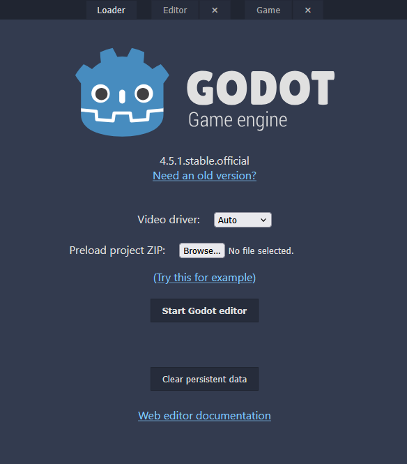

!!! tip "Godot installé sur l'ordinateur"
    Si Godot est déjà installé sur ton ordinateur, tu peux l'utiliser à la place de la version web. Il suffit de glisser et déposer le fichier `flappy_thing.zip` dans la fenêtre des projets.

---

## Étape 3 : Importer le projet

1. Clique sur le bouton **Parcourir...** (ou **Sélection fichier**, selon ton navigateur).
2. Va chercher le fichier `flappy_thing.zip` que tu viens de télécharger dans ton dossier **Téléchargements**.
3. Clique sur **Start Godot Editor**.
4. Dans la fenêtre qui apparaît, donne un nom au projet comme « Mon Flappy Bird ».
5. Clique sur **Installer**. Ça va prendre quelques instants.

!!! warning "Rien ne s'affiche?"
    S'il n'y a rien qui se passe, glisse et dépose le fichier `flappy_thing.zip` sur la page des projets locaux.

---

## Étape 4 : Observation

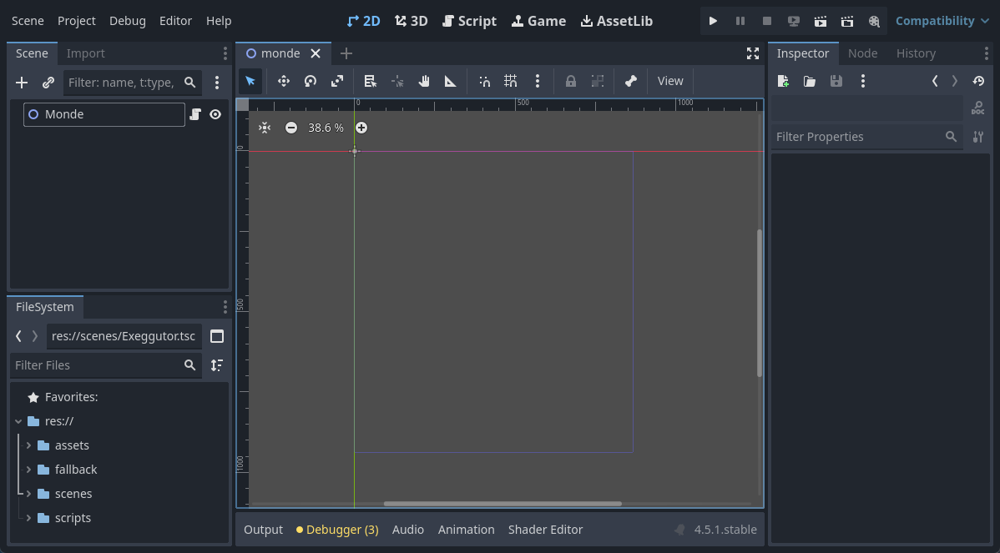

Tu remarques qu'il n'y a pas grand-chose!

- Il y a la scène `Monde`, mais elle est vide.
- On peut remarquer un rectangle bleu-violet. Il définit la dimension de la fenêtre de jeu.
- On va remplir cette scène au fil de l'atelier.

Prends quelques instants pour regarder les fichiers disponibles dans le dossier `assets`.

- Rappel : les fichiers se retrouvent dans le volet inférieur gauche, nommé **Système de fichiers**.

Tu devrais voir les fichiers suivants :

| Fichier | Description |
|---|---|
| `bg.png` | Image d'arrière-plan (*background*) |
| `bird1.png` à `bird3.png` | Images de l'oiseau pour l'animation |
| `ground.png` | Image du sol |
| `pipe.png` | Image du tuyau |
| `restart.png` | Image du bouton pour recommencer |

---

## Étape 5 : Mettre l'arrière-plan

1. Prends le fichier `bg.png` et glisse-le dans la scène `Monde`.
2. Dans l'**Inspecteur** (volet de droite) :
    - Sous la catégorie **Sprite2D > Offset**, décoche `Centered`.
    - Sous la catégorie **Node2D > Transform**, mets `Position` à `x = 0` et `y = 0`.

    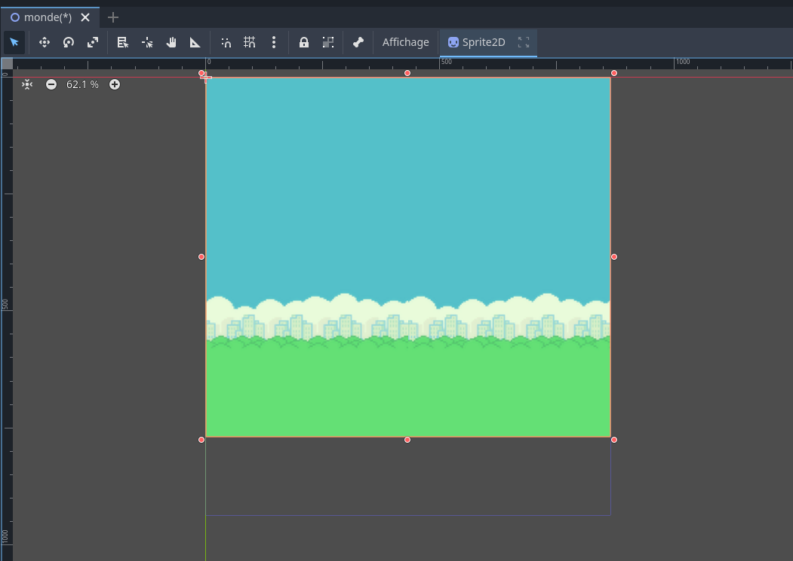

3. **Teste le jeu.** Assure-toi que l'arrière-plan est bien placé. Sinon, prends le temps de l'ajuster.

    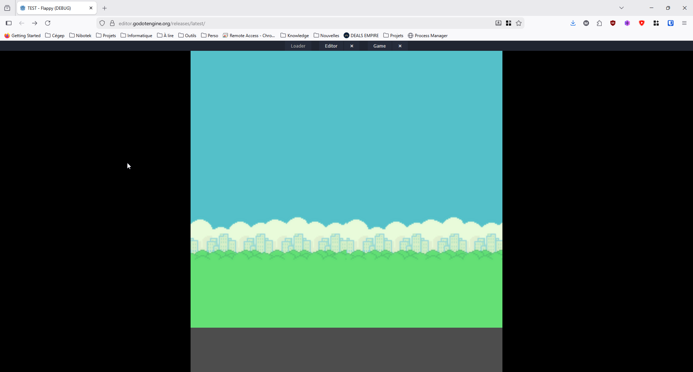

4. Ferme la fenêtre du jeu et reviens à l'éditeur.

---

## Étape 6 : Créer le joueur

### La scène du joueur

1. Crée une nouvelle scène en cliquant sur le **+** à côté du nom de l'onglet `Monde`.
2. Dans le volet Scène, choisis **Autre nœud**.
3. Recherche `CharacterBody2D` et clique sur **Créer**.

<video controls src="assets/040_nouvelle_scene.mp4" title="Nouvelle scène" autoplay muted loop></video>

4. Renomme le nœud `CharacterBody2D` pour `Joueur`.
5. Ajoute au `Joueur` un nœud enfant de type `CollisionShape2D`.
    - Rappel : clique-droit sur le nœud `Joueur`, puis **Ajouter un nœud enfant...**
6. Ajoute au `Joueur` un autre nœud enfant de type `AnimatedSprite2D`.
    - C'est ce nœud qui va gérer l'animation de l'oiseau.
7. Sauvegarde avec `Ctrl + S`. Enregistre la scène sous le nom `joueur.tscn`.

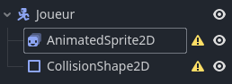

!!! note "Les ⚠️"
    C'est normal! Les nœuds ne sont pas encore configurés. On s'en occupe tout de suite.

### L'animation

1. Sélectionne le nœud `AnimatedSprite2D`.
2. Dans l'**Inspecteur**, trouve la propriété `Sprite Frames` (c'est la première).
3. Clique sur **\<vide\>** et sélectionne **SpriteFrames** dans la liste.
4. Clique de nouveau sur `SpriteFrames`. Le volet **SpriteFrames** devrait apparaître en bas de l'écran.

    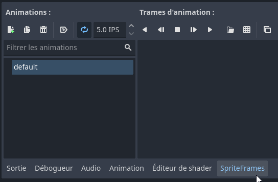

5. Dans le dossier `assets`, trouve `bird1.png` et glisse-le dans la zone **Trames d'animation**.
6. Répète pour `bird2.png` et `bird3.png`.

<video controls src="assets/043_images_animation.mp4" title="Ajouter les images de l'animation" autoplay muted loop></video>

7. Pour voir l'animation, clique sur le bouton *Play* dans le volet **SpriteFrames**.
8. L'animation se nomme présentement `default`. Renomme-la `vol`.

### La zone de collision

1. Sélectionne le nœud `CollisionShape2D`.
2. Dans l'**Inspecteur**, trouve la propriété `Shape`.
3. Clique sur **\<vide\>** et sélectionne `CapsuleShape2D`.
4. Dans **Transform**, change la `Rotation` pour `90°`.
5. Ajuste la taille de la capsule pour qu'elle couvre l'oiseau.

<video controls src="assets/044_creer_oiseau.mp4" title="Créer l'oiseau" autoplay muted loop></video>

---

## Étape 7 : Programmer le joueur

On va maintenant ajouter le code du joueur.

1. Sélectionne le nœud `Joueur` et clique-droit dessus.
2. Sélectionne **Attacher un script...**
3. Décoche le **modèle** (*Template*). On va programmer à partir de rien!
4. Clique sur **Créer**.

### Les variables

Pour gérer le joueur, on va avoir besoin de plusieurs informations :

- La **gravité**
- Sa **vitesse maximale** de chute
- Sa vitesse de **poussée** (le battement des ailes)
- Sa **position de départ**
- Quelque chose pour savoir s'il est **en vol** ou **en chute**

!!! note "C'est quoi une variable?"
    Une variable, c'est un nom qui représente une petite mémoire dans laquelle on stocke de l'information pour la réutiliser plus tard. Une **constante** (`const`), c'est pareil, mais sa valeur ne change jamais.

Selon où tu es rendu dans tes études, il se peut que tu ne comprennes pas tout. Ne t'en fais pas, j'ai fait le code!

1. Dans le système de fichiers, sous le dossier `fallback`, ouvre le fichier `joueur_a_variables.txt`.
2. Copie tout son contenu (`Ctrl + A`, puis `Ctrl + C`).
3. Ouvre le fichier `joueur.gd`.
4. Supprime la ligne qui s'y trouve par défaut.
5. Colle le contenu copié (`Ctrl + V`).

```gdscript
# Code à coller #1

class_name Joueur
extends CharacterBody2D

const GRAVITE : int = 1000
const VIT_MAX : int = 600  # Vitesse maximale
const VIT_POUSSEE : int = -500 # Vitesse de la poussée
const POS_DEPART := Vector2(100, 400) # Position de départ

var en_vol : bool = false # Sera vrai lorsque le joueur volera
var en_chute : bool = false # Indique si l'oiseau a touché au sol, plafond ou tuyau (mort)
```

??? question "Pourquoi la poussée est négative?"
    Dans Godot, l'axe des `y` pointe vers le **bas**. Pour faire monter l'oiseau, il faut donc une vitesse négative!

### Les fonctions `_ready` et `reset`

1. Dans `fallback`, ouvre le fichier `joueur_b_ready_reset.txt`.
2. Copie son contenu et colle-le **à la fin** de `joueur.gd`.

```gdscript
# Code à coller #2

func _ready() -> void:
	reset()

# Permet de remettre à zéro le joueur
func reset() -> void:
	en_vol = false # Il ne vole pas
	en_chute = false # Il ne tombe pas
	position = POS_DEPART # On met remet sa position de départ
	set_rotation(0) # S'il a pivoté, on remet son angle de rotation à 0
```

Il y a deux fonctions : `_ready` et `reset`. Les commentaires (les lignes qui commencent par `#`) décrivent ce que chaque ligne fait.

### La fonction `_physics_process`

1. Dans `fallback`, ouvre le fichier `joueur_c_process.txt`.
2. Copie son contenu et colle-le **à la fin** de `joueur.gd`.

```gdscript
# Code à coller #3

func _physics_process(delta: float) -> void:
	if en_vol or en_chute:
		# Applique la gravité à la vitesse
		velocity.y += GRAVITE * delta

		# Si la vitesse Y est plus grand que la vitesse max
		if velocity.y > VIT_MAX:
			# On limite à la vitesse maximale
			velocity.y = VIT_MAX
		
		
		if en_vol:
			# Applique un angle à l'oiseau selon
			# sa vitesse en Y
			set_rotation(deg_to_rad(velocity.y * 0.05))
			
			# Fait jouer l'animation
			$AnimatedSprite2D.play()
		elif en_chute:
			# elif <-- Sinon si
			# L'oiseau tombe, met pivote l'oiseau à 90°
			set_rotation(deg_to_rad(90))
			
			# Arrête l'animation
			$AnimatedSprite2D.stop()
		
		# Applique les calculs
		move_and_collide(velocity * delta)
	else:
		# Pas en vol ou chute, alors pause?
		# Arrête l'animation
		$AnimatedSprite2D.stop()

# Fonction pour appliquer une poussée
func pousser() -> void:
	velocity.y = VIT_POUSSEE
```

!!! note "La fonction `_physics_process`"
    C'est la fonction qui fait la magie du joueur. Godot l'appelle environ 60 fois par seconde. C'est là qu'on fait une bonne partie des mathématiques et de la logique pour chaque image :

    - On ajoute la gravité à la vitesse, sans dépasser la vitesse maximale.
    - En vol, on incline l'oiseau selon sa vitesse : il pique du nez en tombant.
    - En chute (mort), on le tourne à 90° et on arrête l'animation.

### Mettre le joueur dans le monde

1. Ouvre la scène `Monde`.
2. Glisse le fichier `joueur.tscn` dans la scène.
3. Place-le du côté gauche de l'arrière-plan.
4. **Teste le jeu.**
    - L'oiseau ne fait rien, et c'est normal! On n'a pas encore programmé la souris.

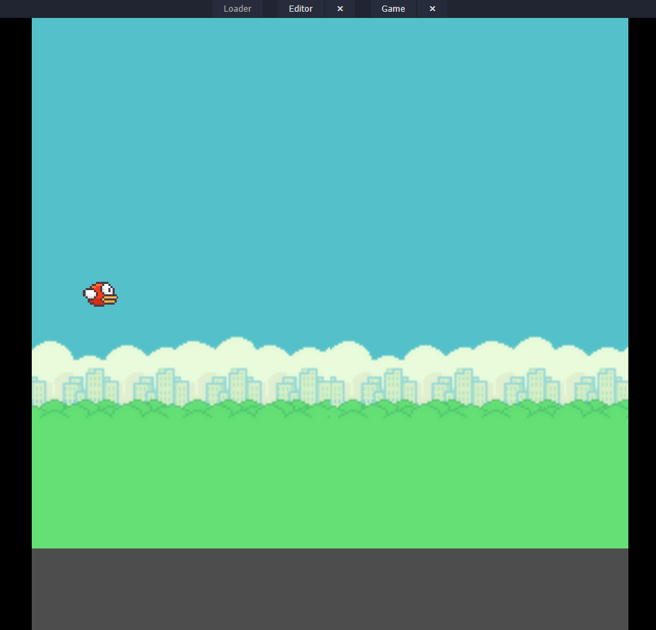

---

## Étape 8 : Programmer le monde

1. Sélectionne le nœud `Monde`, clique-droit dessus et choisis **Attacher un script...**
2. Supprime le contenu du script `monde.gd`.
3. Dans `fallback`, ouvre le fichier `monde_a_base.txt`.
4. Copie son contenu et colle-le dans `monde.gd`.
5. **Teste le jeu** en cliquant avec la souris.

<video controls src="assets/060_test_battement.mp4" title="L'oiseau bat des ailes" autoplay muted loop></video>

??? note "Comment ça fonctionne?"
    La fonction `_input` est appelée chaque fois qu'il se passe quelque chose avec la souris ou le clavier. Si on clique avec le bouton gauche :

    - Si la partie n'est pas commencée, on la démarre.
    - Sinon, on fait pousser l'oiseau vers le haut.

    La touche `Échap` permet de quitter le jeu.

---

## Étape 9 : Le sol

Maintenant que l'oiseau bat des ailes, il faut mettre un peu de viande autour de l'os! On va faire défiler le sol.

1. Reviens en mode **2D**.
2. Dans le dossier `scenes`, glisse le fichier `sol.tscn` sur le nœud `Monde`.

    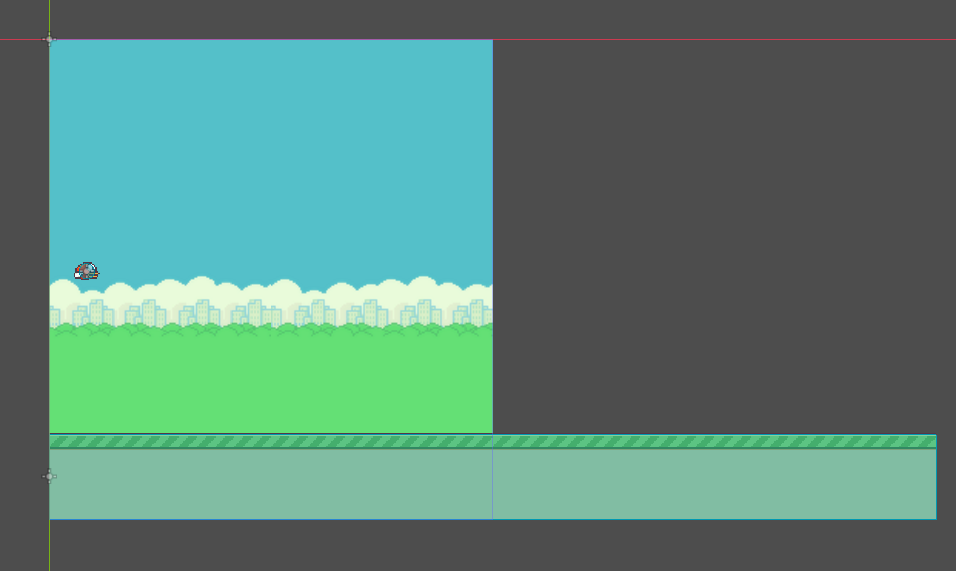

Le sol dépasse de l'écran, c'est normal! La logique, c'est qu'on fait défiler le sol vers la gauche et, quand il arrive au bout, on le replace au début. Comme l'image se répète, on ne voit pas la différence.

3. Dans `fallback`, ouvre le fichier `monde_b_sol.txt`.
4. Remplace **tout** le contenu de `monde.gd` par le contenu de ce fichier.

Ce qu'on a ajouté, c'est la fonction `_process` en bas du script. C'est là qu'on fait les calculs pour déplacer le sol :

```gdscript
func _process(delta: float) -> void:
	if en_execution:
		defilement += VIT_DEFILEMENT
		
		if defilement >= dimension_monde.x:
			defilement = 0.0

		$Sol.position.x = -defilement
```

5. **Teste le jeu.** Tu devrais voir le sol défiler.

<video controls src="assets/071_sol_defile.mp4" title="Le sol défile" autoplay muted loop></video>

---

## Étape 10 : Les tuyaux

J'ai déjà fait la scène des tuyaux. Ouvre la scène `tuyau.tscn` pour voir comment ils fonctionnent. En bref :

- 2 tuyaux placés en haut et en bas
- Des zones de détection de contact
- 1 zone pour donner un point (entre les deux tuyaux)
- 1 script qui indique s'il y a eu un contact ou un point

Dans le jeu, on veut que les tuyaux apparaissent à droite à intervalle régulier, puis défilent vers la gauche. On va utiliser un `Timer` comme chronomètre.

### Le chronomètre

1. Dans la scène `Monde`, sélectionne le nœud `Monde`.
2. Ajoute un nœud enfant de type `Timer`.
3. Renomme-le `TuyauChrono`.
    - Attention à l'orthographe et aux majuscules! Sinon, le code ne fonctionnera pas.
4. Dans l'**Inspecteur**, mets la propriété `Wait Time` à `1.5`.
    - Ce chronomètre va servir à générer un tuyau toutes les 1,5 secondes.

### La scène du tuyau

1. Sélectionne le nœud `Monde`.
2. Dans l'**Inspecteur**, tu devrais voir la propriété `Scene Tuyau`.
3. Trouve le fichier `tuyau.tscn` et glisse-le sur le mot **\<vide\>**.

<video controls src="assets/081_scene_tuyau.mp4" title="Assigner la scène du tuyau" autoplay muted loop></video>

### Le code

1. Dans `fallback`, ouvre le fichier `monde_c_tuyaux.txt` et copie son contenu.
2. Ouvre `monde.gd` et remplace tout le code par celui que tu viens de copier.
    - Ce nouveau code contient des modifications et du nouveau code pour gérer les tuyaux.

### Les signaux

On veut que chaque fois que le chronomètre arrive à zéro, un nouveau tuyau apparaisse à droite.

1. Dans le volet Scène, sélectionne le nœud `TuyauChrono`.
2. Dans le volet de droite, juste à côté de l'onglet **Inspecteur**, clique sur l'onglet **Nœud**.
    - Ce volet affiche les **signaux** (les événements) que le nœud peut émettre.

    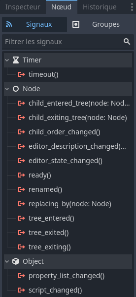

3. Trouve `timeout()`. C'est un événement qui se déclenche chaque fois que le chronomètre est échu.
4. Double-clique dessus. Une fenêtre apparaît : elle permet de connecter une fonction à l'événement.
5. Dans notre cas, la fonction existe déjà dans le code. Clique sur **Connecter**.

    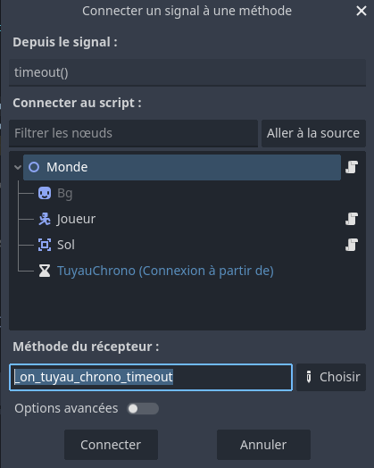

6. **Teste les tuyaux!**

<video controls src="assets/084_test_tuyaux.mp4" title="Test des tuyaux" autoplay muted loop></video>

### Amélioration : l'ordre d'affichage

On remarque que les tuyaux passent devant le sol. Corrigeons ça!

1. Sélectionne le nœud `Sol`.
2. Dans l'**Inspecteur**, trouve la section **CanvasItem**, plus bas.
3. Sous **Ordering**, mets `Z Index` à `1`.
4. **Teste de nouveau.**

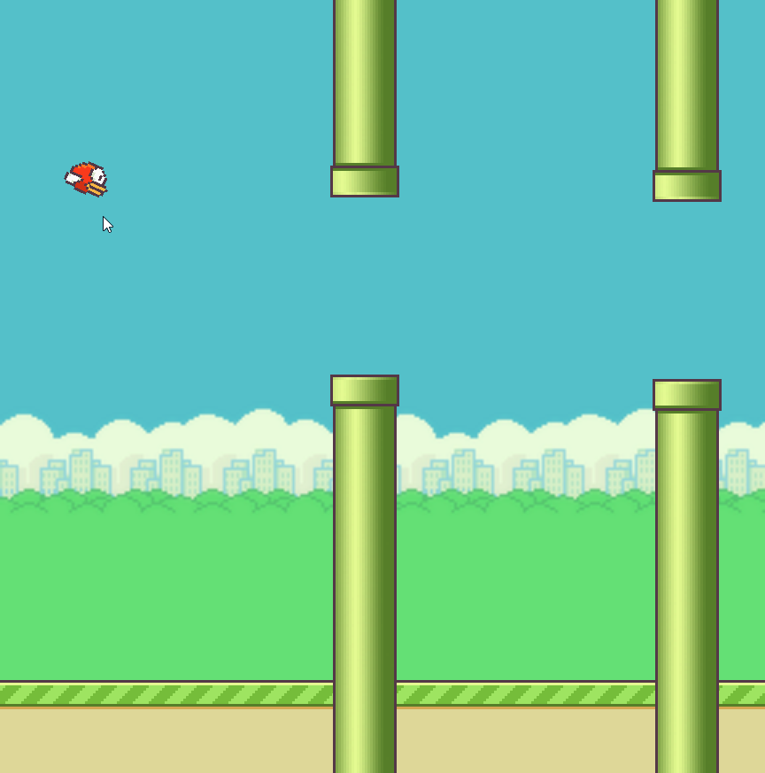

!!! note "Le Z Index"
    Cette valeur change l'ordre d'affichage des nœuds. Plus le chiffre est élevé, plus le nœud est affiché « près de la caméra », donc par-dessus les autres.

---

## Étape 11 : Les collisions

On veut que la partie s'arrête quand l'oiseau touche le plafond, le sol ou un tuyau.

### Les tuyaux

1. Dans `monde.gd`, va vers la ligne **92**. Tu devrais voir `#tuyau.touche.connect(oiseau_touche)`.
2. Retire le caractère `#` au début de la ligne.
    - Chaque fois qu'on crée un nouveau tuyau, cette ligne connecte son signal `touche` à la fonction `oiseau_touche` (vers la ligne 106).
3. **Teste le jeu** et frappe un tuyau.

!!! tip "Aller à une ligne"
    Dans l'éditeur de script de Godot, le raccourci `Ctrl + L` permet d'aller directement à un numéro de ligne.

### Le plafond

1. Vers la ligne **58**, tu devrais voir `#verifier_plafond()`.
2. Retire le caractère `#`.
    - Cette ligne appelle la fonction `verifier_plafond()` (vers la ligne 101). Elle regarde si la position `y` du joueur est plus petite que 0, donc au-dessus de l'écran. Si c'est le cas, on fait chuter l'oiseau et on arrête la partie.

### Le sol

1. Sélectionne le nœud `Sol`.
2. Dans l'onglet **Nœud** (à droite de l'onglet **Inspecteur**), tu devrais voir `sol_touche()`.
3. Double-clique dessus.
4. Dans la nouvelle fenêtre, clique sur **Connecter**.
    - Ça connecte l'événement `sol_touche` à la fonction `_on_sol_sol_touche()` qui est déjà dans le code. Cette fonction arrête la chute de l'oiseau (il est déjà au sol) et arrête la partie.
5. **Teste** la collision avec le plafond, puis avec le sol.

<video controls src="assets/090_collisions.mp4" title="Les collisions" autoplay muted loop></video>

---

## Étape 12 : Le pointage

On veut un système de pointage simple : chaque fois que l'oiseau traverse un tuyau, on ajoute 1 point.

1. Sélectionne le nœud `Monde`.
2. Ajoute un nœud enfant `Label` (*label* veut dire « étiquette »).
3. Renomme-le `ScoreLabel`.
    - Attention à l'orthographe et aux majuscules!

    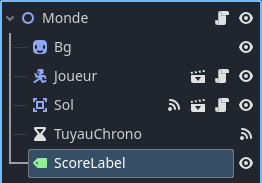

4. Dans la propriété `Text`, écris `Score : 0`.

    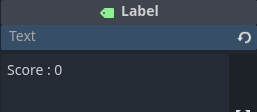

5. Le texte devrait apparaître dans le coin supérieur gauche. Déplace-le vers le centre de l'écran.

    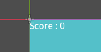

Le texte est un peu petit, on va l'agrandir.

1. Dans l'**Inspecteur**, trouve la section **Control**.
2. Sous **Theme Overrides > Font Sizes**, mets la valeur à `40`.
3. Dans la section **CanvasItem**, sous **Ordering**, mets `Z Index` à `1`.
    - C'est pour que le pointage s'affiche devant les tuyaux.

Il reste à activer le code :

1. Dans `monde.gd`, retire le caractère `#` devant les lignes `#$ScoreLabel.text = "SCORE : " + str(score)`. Il y en a deux :
    - vers la ligne **36** (remet le pointage à 0 au début d'une partie)
    - vers la ligne **95** (ajoute un point)
2. **Teste le jeu.**

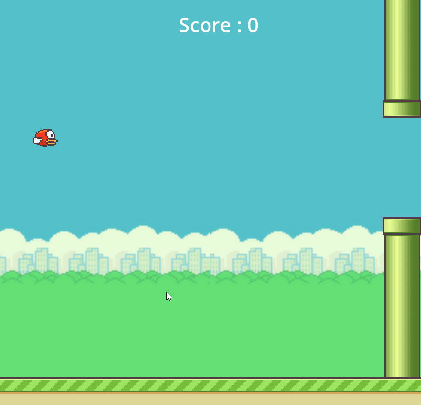

---

## Étape 13 : Redémarrer la partie

Il n'y a aucun moyen de recommencer la partie pendant le jeu. J'ai fait une scène pour ça : c'est seulement un bouton avec un peu de code.

1. Dans le dossier `scenes`, trouve le fichier `fin_partie.tscn`.
2. Glisse-le sur le nœud `Monde`.

<video controls src="assets/110_fin_partie.mp4" title="Ajouter la fin de partie" autoplay muted loop></video>

3. Sélectionne le nœud `FinPartie`.
4. Dans l'onglet **Nœud**, double-clique sur l'événement `redemarrer()`.
5. Dans la nouvelle fenêtre, clique sur **Connecter**.
6. Dans `monde.gd`, retire le caractère `#` aux lignes **38** (`#$FinPartie.hide()`) et **119** (`#$FinPartie.show()`).
7. **Teste le jeu.** Le jeu devrait maintenant être complet!

<video controls src="assets/120_jeu_complet.mp4" title="Jeu complété" autoplay muted loop></video>

---

## Supplément

- Pour augmenter la difficulté, essaie de modifier la scène `tuyau.tscn` (l'espace entre les tuyaux, par exemple) ou les constantes au début de `monde.gd` (`VIT_DEFILEMENT`, `PLAGE_TUYAU`).
- Dans le dossier `assets`, j'ai aussi mis d'autres images que l'oiseau et le tuyau de base si tu veux donner un autre style à ton jeu.

---

## Références

- [Tutoriel Flappy Bird dans Godot (source du code de base)](https://www.youtube.com/watch?v=9f9t9eiCDAA){target=_blank}
- [Ma chaîne YouTube](https://www.youtube.com/@NicolasBourre){target=_blank}
- [Godot Engine](https://godotengine.org/){target=_blank}
