# Atelier numéro 2 : Jeu de plateforme

!!! danger "À réviser"
    Note pour l'enseignant : cette leçon doit être révisée avant d'être utilisée en classe.

<video controls src="assets/001_demo.mp4" title="Démonstration du jeu de plateforme" autoplay muted loop></video>

## Objectifs
L'objectif de cet atelier est de créer le début d'un petit jeu de type **plateforme**. Étant donné le temps limité, certains éléments sont fournis et préparés d'avance : le personnage, un ennemi, des pièces, de la musique et une plateforme mobile.

On va apprendre à :

- Placer des scènes dans le monde
- Attacher un script à un personnage
- Dessiner un niveau avec des tuiles
- Ajouter une caméra
- Gérer la mort du personnage
- Afficher un pointage

---

## Prérequis

- Avoir accès à Godot (Version Web ou installée sur l'ordinateur)
    - Pour la version Web, avoir un navigateur **Edge** ou **Chrome**
- Télécharger le fichier `Jeu-Plateforme.zip`

!!! note "Dépannage pour la version Web"

    Si ton Godot Web ne semble plus fonctionner ou est instable, va voir la [page de dépannage](../depannage/index.md){target=_blank} pour voir les étapes à suivre pour régler le problème.

---

## Introduction

Faire un jeu vidéo, qu'est-ce qu'il faut?

- Vouloir apprendre
- Être autodidacte
- Modérer ses attentes

Nous allons utiliser un logiciel pour faire des jeux vidéo qui s'appelle **Godot**. Il est gratuit, open source et relativement facile à apprendre pour les débutants.

!!! info "Pourquoi pas Unity ou Unreal Engine?"
    Ces logiciels sont de gros bouffeurs de ressources. Godot fonctionne même directement dans le navigateur, ce qui nous évite toute installation.

Godot est principalement en anglais. En passant, être capable de lire l'anglais de base est super important dans le monde de l'informatique et des sciences!

---

## Étape 1 : Télécharger les ressources

1. Dans ton navigateur, va à l'adresse suivante : [https://tinyurl.com/ateliers-jeux](https://tinyurl.com/ateliers-jeux){target=_blank}
2. Dans la page, il y a un petit tableau. Clique sur le lien `Jeu-Plateforme.zip`.

    

3. Le fichier sera téléchargé et se retrouvera dans ton dossier **Téléchargements**.
    - **Ne l'ouvre pas!** On va le donner directement à Godot.

---

## Étape 2 : Ouvrir Godot sur le Web

!!! tip "Godot installé sur l'ordinateur"
    Si Godot est déjà installé sur ton ordinateur, tu peux l'utiliser à la place de la version web. Il suffit de glisser et déposer le fichier `Jeu-Plateforme.zip` dans la fenêtre des projets.

1. Ouvre le navigateur **Edge** ou **Chrome**.
2. Va à la page suivante : [https://tinyurl.com/gd4web](https://tinyurl.com/gd4web){target=_blank}
3. Si une fenêtre surgit avec un texte, clique sur le bouton **Ok, don't show again**.

<video controls src="assets/020_godot_web.mp4" title="Ouvrir Godot Web" autoplay muted loop></video>

---

## Étape 3 : Ouvrir le projet sur la version **Ordinateur**

!!! info "Godot Web ou Ordinateur?"
    Fais seulement l'étape 3 qui correspond à ta version de Godot. Si tu utilises Godot Web, passe directement à la [version Web](#etape-3-ouvrir-le-projet-via-godot-web).

1. Lance **Godot** sur ton ordinateur.
    - La fenêtre du **gestionnaire de projets** s'ouvre.
2. Ouvre l'**explorateur de fichiers** avec le raccourci `Windows + E`.
    - La touche `Windows` est celle avec le logo de Windows, en bas à gauche du clavier.
3. Dans le volet de gauche de l'explorateur, clique sur **Téléchargements**.
4. Trouve le fichier `Jeu-Plateforme.zip`.
    - **Ne double-clique pas dessus!** On ne veut pas l'ouvrir ni l'extraire.
5. Place les deux fenêtres côte à côte, puis glisse et dépose le fichier `Jeu-Plateforme.zip` dans la fenêtre du gestionnaire de projets de Godot.
6. Dans la fenêtre qui apparaît, donne un nom au projet comme « Jeu de plateforme ».
7. Clique sur **Importer** (ou **Importer et éditer**, selon ta version).
    - Le projet s'ouvre dans l'éditeur après quelques instants.

---

## Étape 3 : Ouvrir le projet via **Godot Web**

1. Clique sur le bouton **Sélection fichier**.
2. Sélectionne le fichier que tu as téléchargé précédemment.
    - Il y a de bonnes chances qu'il soit dans ton dossier **Téléchargements**.
    - Il devrait se nommer `Jeu-Plateforme.zip`.
3. Clique sur **Ouvrir**.
4. Clique sur **Start Godot Editor**.
    - Cela peut prendre quelques minutes avant d'avoir quelque chose à l'écran.
5. Dans la fenêtre qui apparaît, donne un nom au projet comme « Jeu de plateforme ».
6. Clique sur **Installer**. Ça va prendre quelques instants.

!!! warning "Rien ne s'affiche?"
    S'il n'y a rien qui se passe, glisse et dépose le fichier `Jeu-Plateforme.zip` sur la page des projets locaux.


---

## Étape 4 : L'environnement


Tu remarques que c'est probablement un environnement assez différent de ce à quoi tu es habitué. Les développeurs utilisent des logiciels très différents selon l'emploi qu'ils occupent. Ça peut aller du simple éditeur de texte à des environnements complexes de gestion de réseau, en passant par des logiciels spécialisés en programmation. Si tu fais des jeux vidéo plus tard, tu auras sûrement un logiciel semblable.

Ne t'inquiète pas, comme on dit : *tu vas apprendre l'outil sur le tas!*

L'environnement est divisé en plusieurs zones :

1. **Le volet Scène** (en haut à gauche) : affiche les éléments de la scène active.
2. **Le système de fichiers** (en bas à gauche) : affiche les ressources du projet.
3. **La zone de travail** (au centre) : c'est là que tu construis ta scène.
4. **Le bouton Exécuter** (le triangle *Play*, en haut à droite) : permet de tester le jeu.

---

## Étape 5 : Exploration

### La zone de travail

Étant donné que l'on part avec un projet déjà débuté, la première chose à faire est de regarder les ressources que l'on a. Les ressources peuvent être des images, des sons ou des éléments du jeu comme un personnage.

**Ne clique nulle part pour l'instant. Patience!**

On remarque que la zone de travail a un onglet nommé `Monde` (dans la partie du centre, un peu à gauche). Il s'agit de la scène **Monde**.

<video controls src="assets/040_exploration.mp4" title="Exploration" autoplay muted loop></video>

### Le volet Scène

Dans le volet de gauche, c'est la scène active dans la zone de travail qui est affichée.

!!! note "C'est quoi une scène?"
    Une scène, c'est un peu comme une scène d'une pièce de théâtre. C'est l'assemblage de tous les éléments qui la composent : le personnage, le décor, les ennemis, les PNJ, etc.

    Si l'on « zoome » un peu sur un personnage de jeu, lui-même est une scène, car il est composé de plusieurs éléments tels que son habillage, ses armes, etc.

<video controls src="assets/041_volet_scene.mp4" title="Le volet Scène" autoplay muted loop></video>

### Le système de fichiers

Les ressources se retrouvent dans le volet inférieur gauche sous l'onglet **Système de fichiers**. On y voit `res://` et en dessous le dossier `assets`. Il y a aussi plusieurs autres fichiers que l'on utilisera en temps et lieu.

<video controls src="assets/042_systeme_fichiers.mp4" title="Système de fichiers" autoplay muted loop></video>

- Le fichier `monde.tscn` représente la scène **Monde** qui est ouverte dans la zone de travail.
    - Pour l'instant il n'y a pas grand-chose, mais on va la remplir plus tard.
- Double-clique sur le fichier `joueur.tscn`. Ça ouvre la scène **Joueur**.
    - Remarque les onglets de la zone de travail : on devrait avoir `Monde` et `Joueur`.
- Si tu cliques sur l'onglet `Monde`, le contenu du volet Scène revient à `Monde`.
- Reviens à la scène `Joueur`.

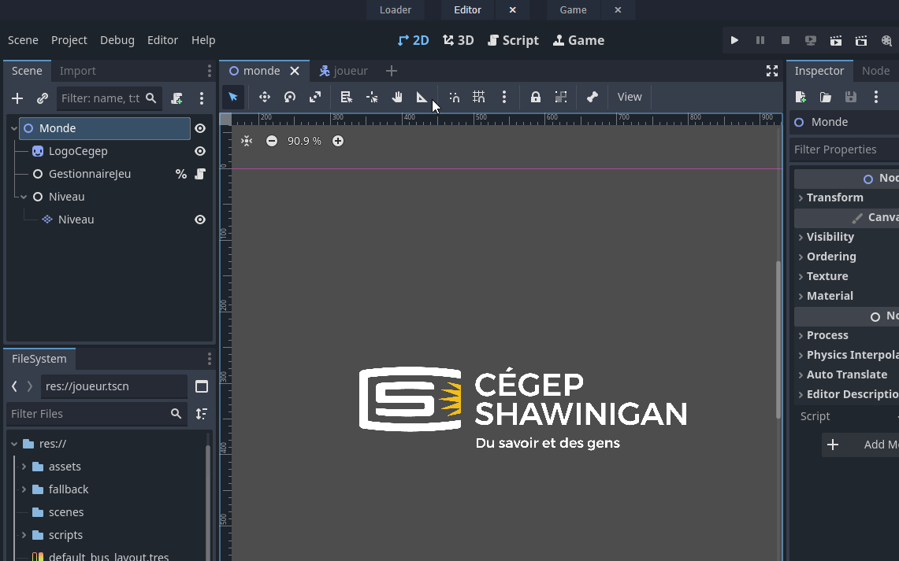

---

## Étape 6 : Le joueur

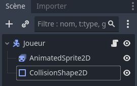{ align=right }

Tu remarques que la scène du joueur a un contenu différent de la scène du monde. Pour accélérer le développement, j'ai mis en place des **nœuds** dans la scène `Joueur`.

!!! note "C'est quoi un nœud?"
    Un nœud est un élément de base dans Godot. On utilise le mot « nœud » pour faire une analogie avec un nœud dans un arbre et ses branches. Il peut s'agir d'une image, d'une zone de collision, d'un gestionnaire d'animation, etc.

    Il y a beaucoup de types de nœuds, mais apprendre leur fonctionnement sort de l'objectif de l'atelier. Il faut « speed run » le développement!

### Naviguer dans la zone de travail

- Avec une souris :
    - Fais rouler la molette dans la zone de travail pour agrandir ou réduire la vue.
    - Appuie sur `F` pour centrer la scène.
    - Clique sur la molette et déplace la souris pour déplacer la vue.
- Avec un trackpad :
    - Fais glisser deux doigts sur le trackpad pour te déplacer et agrandir la vue.
- Ajuste la vue pour que l'encadré rose/bleu prenne l'ensemble de la zone de travail.

<video controls src="assets/051_zoom_souris.mp4" title="Zoom avec la souris" autoplay muted loop></video>

??? example "Avec un trackpad"
    <video controls src="assets/052_zoom_trackpad.mp4" title="Zoom avec le trackpad" autoplay muted loop></video>

### Les nœuds du joueur

Dans le volet Scène, on retrouve les nœuds qui composent le personnage :

- **Joueur** (le nœud parent) : devant le nœud, tu remarques l'icône d'un petit personnage. Il s'agit d'un nœud de type `CharacterBody2D` qui permet de gérer la physique du personnage. Ce nœud doit posséder d'autres nœuds pour bien fonctionner.
- **AnimatedSprite2D** : contient les animations du personnage.
- **CollisionShape2D** : définit la zone physique du personnage.

!!! note "Les animations 2D"
    Les animations dans un jeu vidéo 2D sont réalisées comme dans l'ancien temps : on affiche une séquence d'images à grande vitesse pour avoir l'illusion d'un mouvement.

---

## Étape 7 : Mettre le joueur dans le monde

1. Sélectionne l'onglet de la scène `Monde`.
2. Glisse et dépose le fichier `joueur.tscn` sur le nœud `Monde` dans le volet Scène.
3. Le joueur apparaît dans la scène `Monde` à la position (0, 0).
    - Appuie sur `F` pour centrer la vue sur le joueur.

    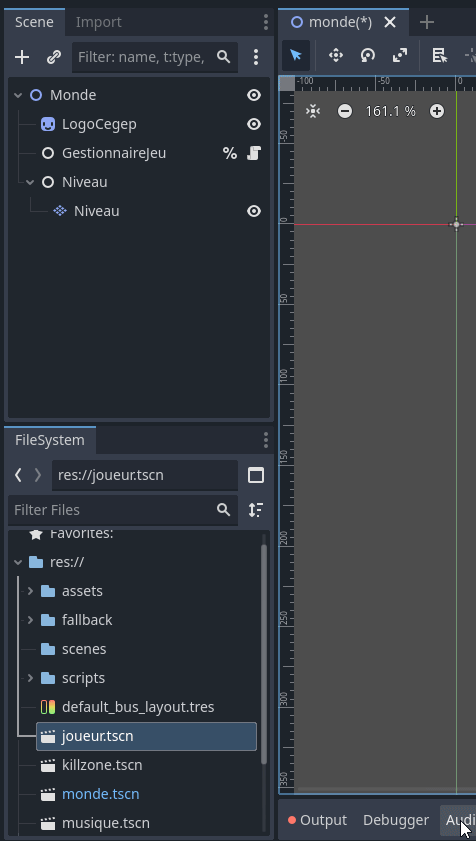

4. Sélectionne le personnage et glisse-le près du logo du Cégep.

    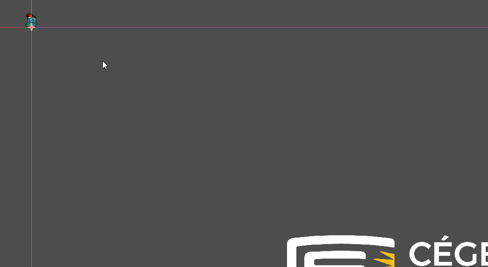

5. **Teste le jeu.** Dans le coin supérieur droit, clique sur le bouton **Play**.

    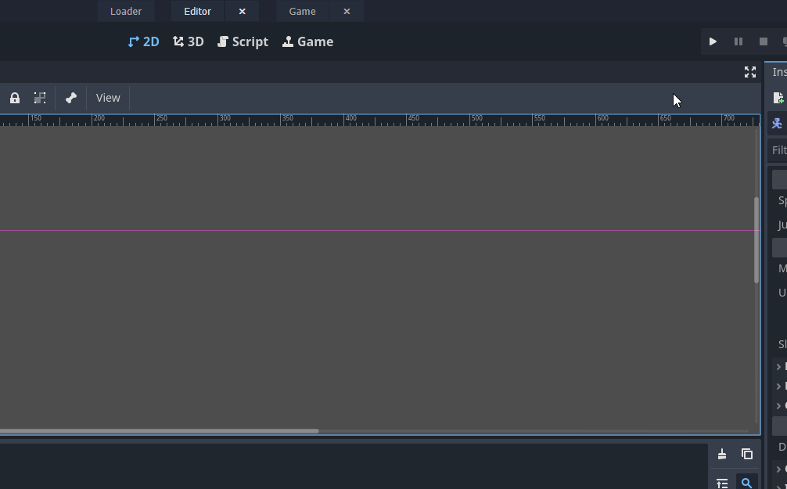

Que se passe-t-il? (1)
{ .annotate }

1.  Rien de bien excitant... Le personnage est là, mais il ne bouge pas. Félicitations quand même, c'est ton premier jeu!

- Si tu es dans la version web de Godot :
    - Dans la barre supérieure, clique sur le `X` à côté de **Game** pour revenir au développement.
- Si tu es dans la version installée sur ton ordinateur :
    - Tu peux fermer la fenêtre du jeu pour revenir au développement.

---

## Étape 8 : Programmer le joueur

Il est maintenant temps de faire comme tout programmeur : programmer!

1. Active la scène `Joueur`.
2. Sélectionne le nœud `Joueur`.
3. Pour ajouter du code, on doit **attacher un script** au nœud. Dans le coin supérieur droit du volet Scène, il y a une petite icône en forme de parchemin avec un petit plus vert. Clique dessus.

    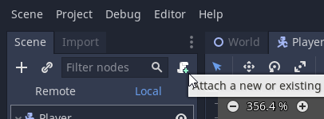

    <video controls src="assets/070_attacher_script.mp4" title="Attacher un script" autoplay muted loop></video>

4. Une fenêtre va apparaître. Clique sur **Créer**.
5. Une fenêtre avec du texte va s'afficher. Il s'agit du code de base que Godot propose pour programmer un `CharacterBody2D`.

    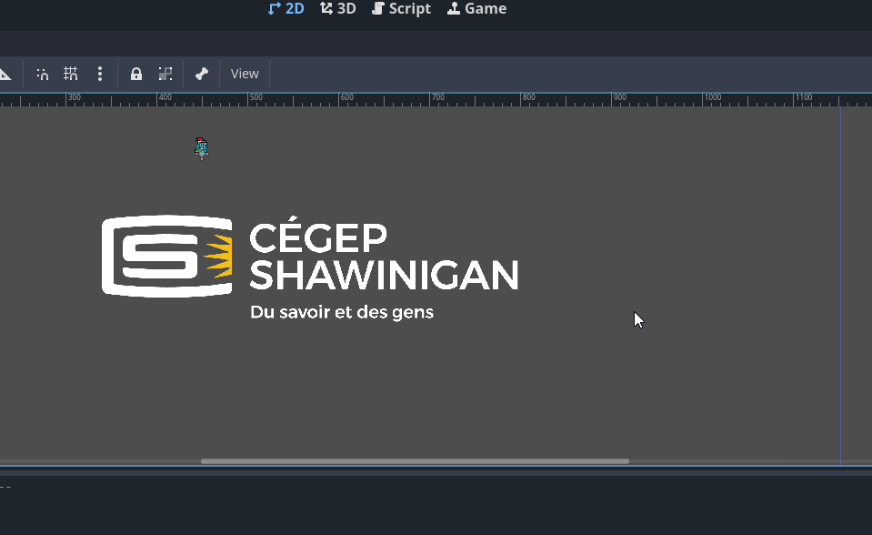

!!! tip "Passer du code au design"
    Dans la barre centrale supérieure, clique sur **2D** pour revenir en mode « design ». Clique sur **Script** pour revenir au code.

---

### Étape 8b : Ajouter un plancher

Godot donne du code de base, mais il manque des trucs. On va ajouter un plancher rapidement pour voir si ça fonctionne bien.

1. Reviens à la scène `Monde`.
2. Dans le volet Scène, repère le nœud `Map`.
    - Tu en as peut-être 2, un en dessous de l'autre. Sélectionne celui qui est le plus bas.

    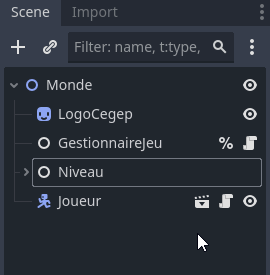

3. Le volet inférieur change et affiche plein de petites images. Ce sont des **tuiles** qui vont nous permettre de dessiner le niveau.
    - Tu peux agrandir l'affichage en faisant rouler la molette de la souris.

    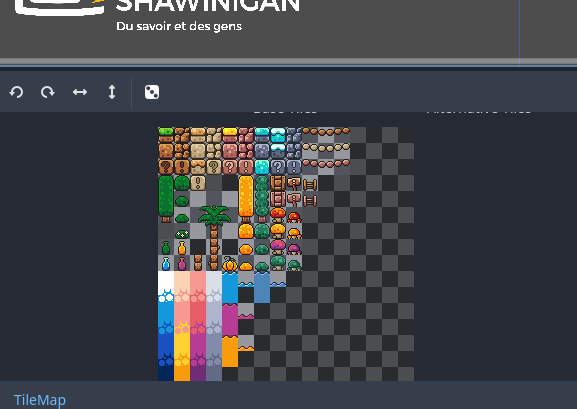

4. Vois-tu un carré jaune lorsque tu promènes la souris sur les tuiles? Ça va nous permettre de dessiner.
5. Sélectionne la tuile avec du gazon.
    - C'est comme un programme de dessin, mais avec des tuiles.
6. Trace quelques tuiles en dessous du logo, sous le personnage.
    - Tu peux effacer une ou plusieurs tuiles avec le **bouton droit** de la souris.

    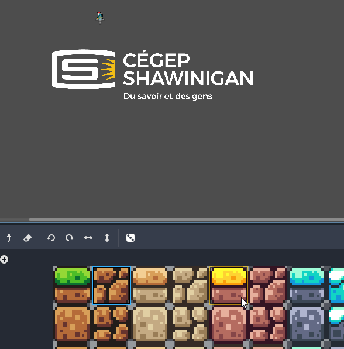

7. **Teste le jeu.**
    - Tu peux déplacer le personnage avec les flèches du clavier.
    - Pour sauter, appuie sur `Espace`.

    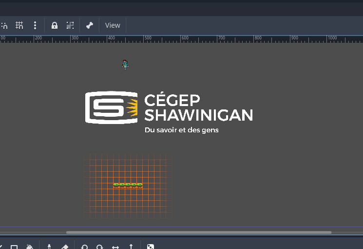

Parfait! On va revenir plus tard au niveau. Pour l'instant, on doit améliorer le personnage.

---

## Étape 9 : Caméra!

As-tu remarqué que le personnage est très petit? C'est parce qu'on n'a pas mis de caméra.

1. Dans la scène `Joueur`, sélectionne le nœud `Joueur`.
2. Clique-droit dessus et sélectionne **Ajouter un nœud enfant...**

    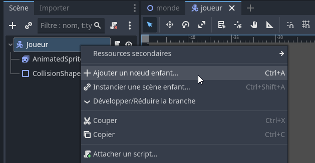

3. Dans la fenêtre qui apparaît, recherche `Camera`.
4. Sélectionne `Camera2D` et appuie sur **Créer**.
    - La caméra va suivre le joueur dans le jeu.

    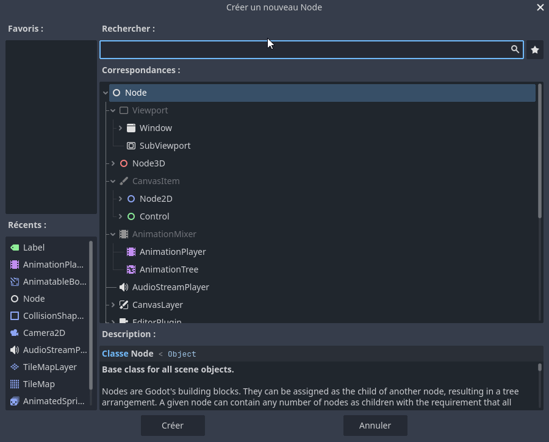

5. **Teste le jeu.**

Ça fonctionne, mais c'est encore petit. Il faut ajuster le zoom.

1. Dans le volet Scène, sélectionne le nœud `Camera2D`.
2. Complètement à droite de l'écran, dans l'**Inspecteur**, tu devrais voir plein de propriétés.
3. Recherche `Zoom`.
4. Mets `4.0` dans le `x`.

    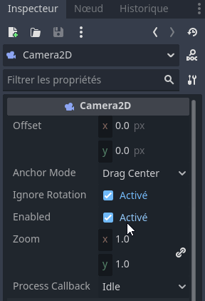

5. **Teste le jeu.** Et puis?

---

## Étape 10 : Modifier le code du joueur

Si tu as remarqué, le personnage se promène toujours en regardant du même côté et n'a pas d'animation. On va améliorer son code.

1. Va dans le code du joueur en cliquant sur le bouton **Script** au milieu, en haut de la fenêtre.

    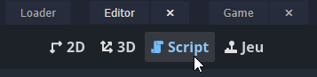

2. Assure-toi que `joueur.gd` est sélectionné dans le volet de gauche.
    - La première ligne de code devrait débuter par `extends CharacterBody2D`.

    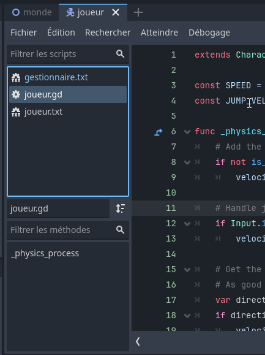

3. Sélectionne tout le code avec le raccourci `Ctrl + A`.
4. **Supprime le code!** On va le remplacer.

    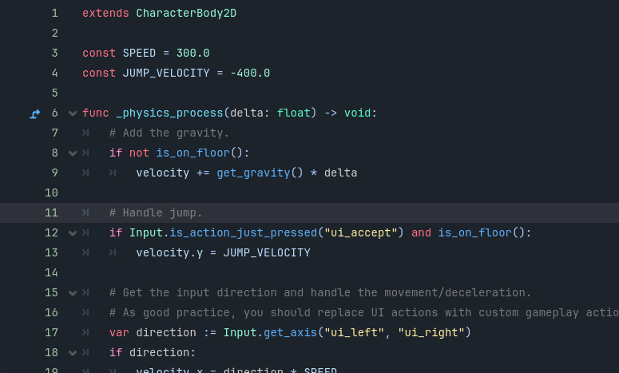

5. Dans le système de fichiers en bas à gauche, ouvre le dossier `fallback`.
6. Double-clique sur le fichier `joueur.txt` pour l'ouvrir.
    - Tu devrais maintenant voir `joueur.gd(*)` et `joueur.txt` dans le volet des fichiers ouverts.

    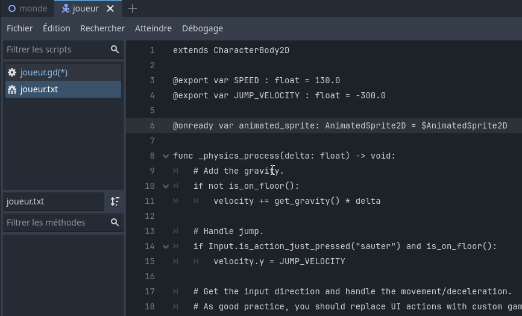

7. Dans `joueur.txt`, fais `Ctrl + A` pour tout sélectionner, puis `Ctrl + C` pour copier.
8. Sélectionne le fichier `joueur.gd` et colle le contenu avec `Ctrl + V`.
    - Le code devrait maintenant être en couleur.

    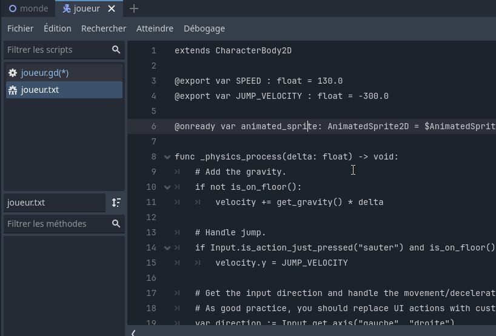

Voici le code que tu devrais avoir :

```gdscript
extends CharacterBody2D

@export var SPEED : float = 130.0
@export var JUMP_VELOCITY : float = -300.0

@onready var animated_sprite: AnimatedSprite2D = $AnimatedSprite2D

func _physics_process(delta: float) -> void:
	# Add the gravity.
	if not is_on_floor():
		velocity += get_gravity() * delta

	# Handle jump.
	if Input.is_action_just_pressed("sauter") and is_on_floor():
		velocity.y = JUMP_VELOCITY

	# Get the input direction and handle the movement/deceleration.
	# As good practice, you should replace UI actions with custom gameplay actions.
	var direction := Input.get_axis("gauche", "droite")
	
	# Obtenir la direction : -1, 0 , 1
	
	if direction > 0:
		animated_sprite.flip_h = false
	elif direction < 0:
		animated_sprite.flip_h = true
	
	# Jouer les animations
	if is_on_floor():
		if direction == 0:
			animated_sprite.play("repos")
		else:
			animated_sprite.play("courir")
	else:
		animated_sprite.play("sauter")
	
	if direction:
		velocity.x = direction * SPEED
	else:
		velocity.x = move_toward(velocity.x, 0, SPEED)

	move_and_slide()
```

!!! note "Qu'est-ce qui a changé?"
    - `flip_h` permet de retourner l'image du personnage horizontalement selon la direction dans laquelle il se déplace.
    - Selon qu'il est au sol ou en l'air, et qu'il bouge ou non, on joue l'animation `repos`, `courir` ou `sauter`.

9. **Teste le jeu!**

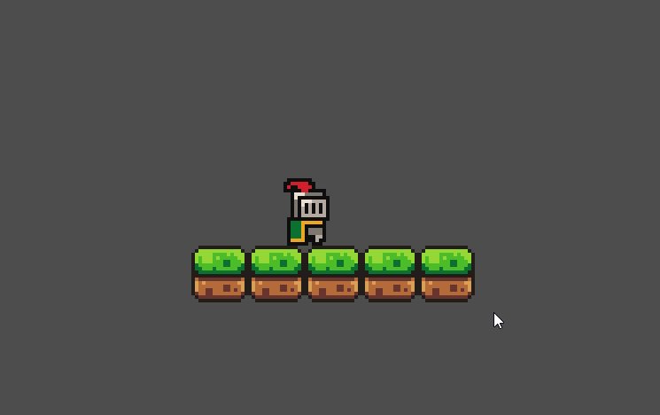

---

## Étape 11 : La mort...

Si on tombe de la plateforme, que se passe-t-il? On aimerait que le jeu recommence lorsque le personnage tombe. J'ai fait une petite scène pour nous simplifier la vie.

1. Retourne dans la scène `Monde` en mode 2D.
    - Profites-en pour descendre ton personnage plus bas, près de la plateforme.
2. Recherche le fichier `killzone.tscn` et glisse-le sur le nœud `Monde`.

    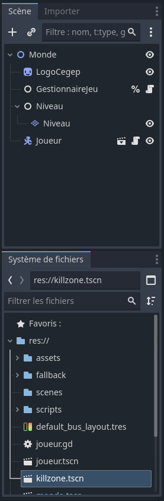

3. Tu remarques un ⚠️ à côté de `Killzone`. C'est parce qu'on doit définir une zone pour la mort. Ce que l'on veut, c'est tout le plancher.
4. Clique-droit sur le nœud `Killzone` et fais **Ajouter un nœud enfant...**
5. Recherche et ajoute un `CollisionShape2D`.

    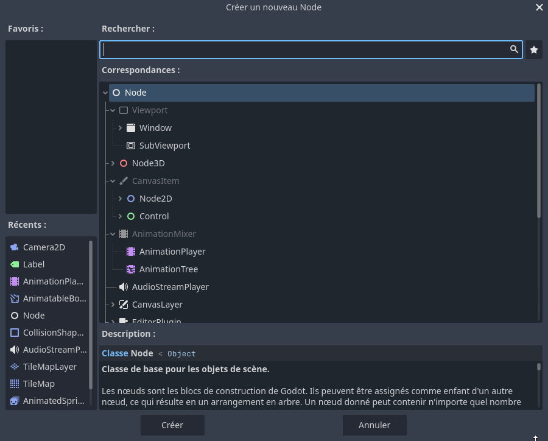

6. Maintenant, il y a un ⚠️ à côté de `CollisionShape2D`. C'est qu'on n'a pas donné de forme à la collision.
7. À droite de l'écran, dans l'**Inspecteur**, recherche la propriété `Shape`.
8. Clique sur le champ **vide** et sélectionne `WorldBoundaryShape2D` dans la liste.
    - Ça indique que la forme est une limite du monde.

    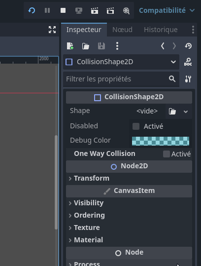

9. **Teste le jeu.**

Qu'arrive-t-il? (1)
{ .annotate }

1.  Le jeu recommence sans arrêt! C'est une boucle infinie, parce que la limite du monde est à la position (0, 0), donc à la même hauteur que le joueur.

On doit placer la limite du monde plus bas.

1. Sélectionne le nœud `Killzone`.
2. À droite du cadenas dans la barre d'outils au-dessus de la zone de travail, il y a une petite icône avec deux carrés. Clique dessus.
    - Ça permet de grouper les nœuds ensemble pour les déplacer d'un bloc.

    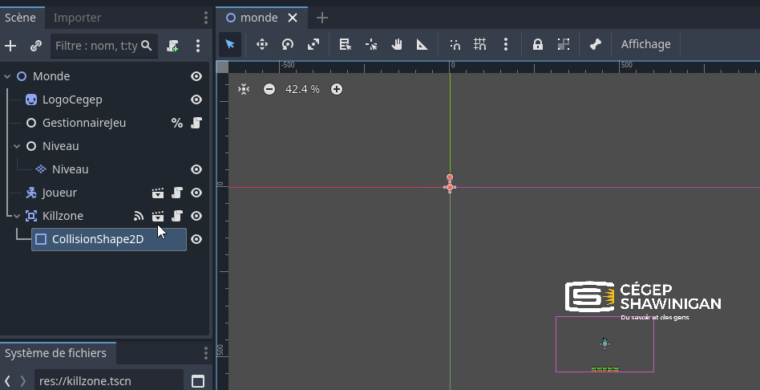

3. Va au point (0, 0) du jeu, là où les lignes verte et rouge se croisent. Tu devrais voir `Killzone`.
4. Sélectionne-la et glisse-la vers le bas de l'écran, sous la plateforme.

    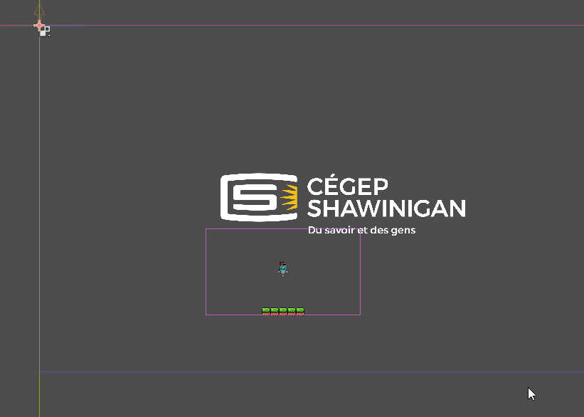

5. **Teste le jeu** en tombant de la plateforme. Tu devrais pouvoir mourir et recommencer.

---

## Étape 12 : Un autre palier

1. Sélectionne le nœud `Map`.
2. Dans le volet **TileMap**, sélectionne une tuile de gazon (ou une autre que tu aimes).
3. Trace deux autres paliers.
4. **Teste le jeu.**

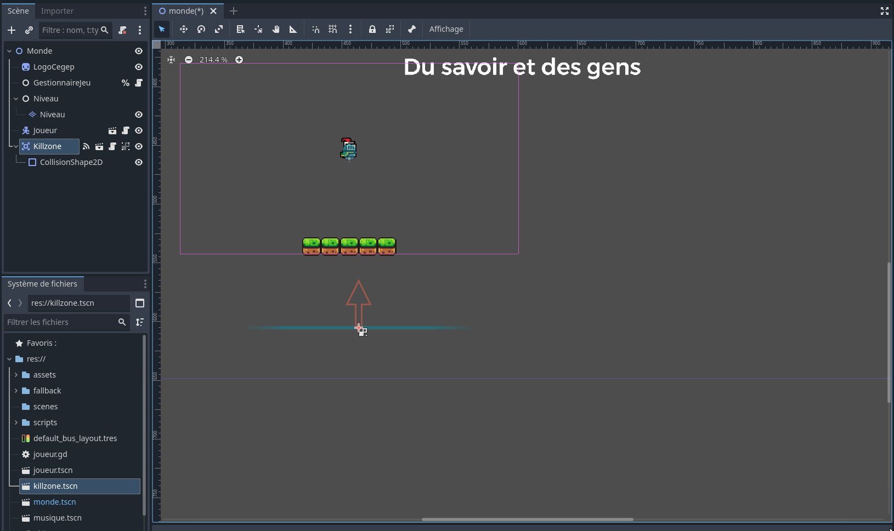

---

## Étape 13 : Un ennemi

J'ai fait un ennemi pour que tu puisses l'ajouter rapidement dans le jeu.

1. Recherche le fichier `slime.tscn`.
2. Ajoute-le au milieu du 2e palier.
3. **Teste le jeu.** Que se passe-t-il?

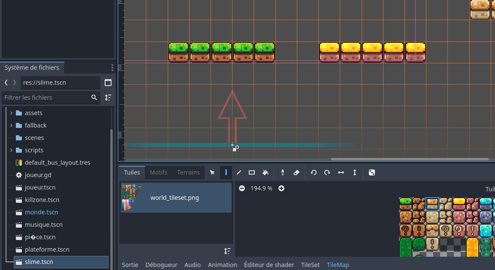

L'ennemi ne peut voir que les murs devant lui pour se retourner. Il faut donc le bloquer.

1. Ajoute un mur (des tuiles) à chaque extrémité du palier.
2. **Teste le jeu.** Touche à l'ennemi pour voir ce qui arrive!

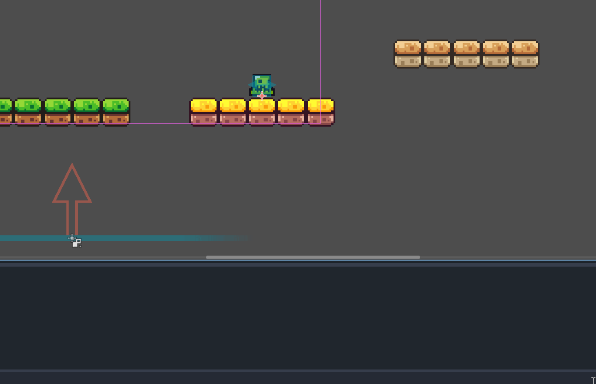

---

## Étape 14 : Les pièces de monnaie

Ça serait le fun de pouvoir récolter des pièces de monnaie. J'ai aussi fait des pièces!

1. Trouve le fichier `piece.tscn`.
2. Glisses-en 3 ou 4 sur les paliers.
3. **Teste le jeu.** Monte le son!

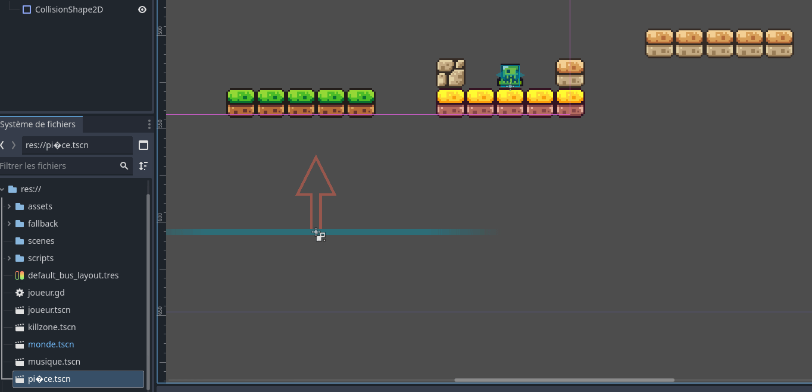

---

## Étape 15 : Musique

Il y a aussi la possibilité de mettre de la musique.

1. Double-clique sur le fichier `musique.tscn`.
2. Sélectionne le nœud `Musique`.
3. Dans l'**Inspecteur** à droite de l'écran, recherche `Autoplay`.
4. Coche l'option **Activé**.
5. **Teste le jeu.**

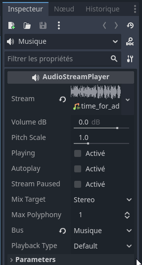

!!! warning "Le jeu ne veut plus se relancer sur le web?"
    Si le jeu refuse de se réexécuter dans Godot Web, décoche l'option `Autoplay` de la musique. Ça semble causer le problème.

---

## Étape 16 : Pointage

Ça serait le fun de voir le nombre de pièces récoltées.

1. Dans le volet Scène de `Monde`, trouve le nœud `GestionnaireJeu`.
2. Clique-droit dessus et fais **Ajouter un nœud enfant...**
3. Recherche et ajoute un `Label`.

    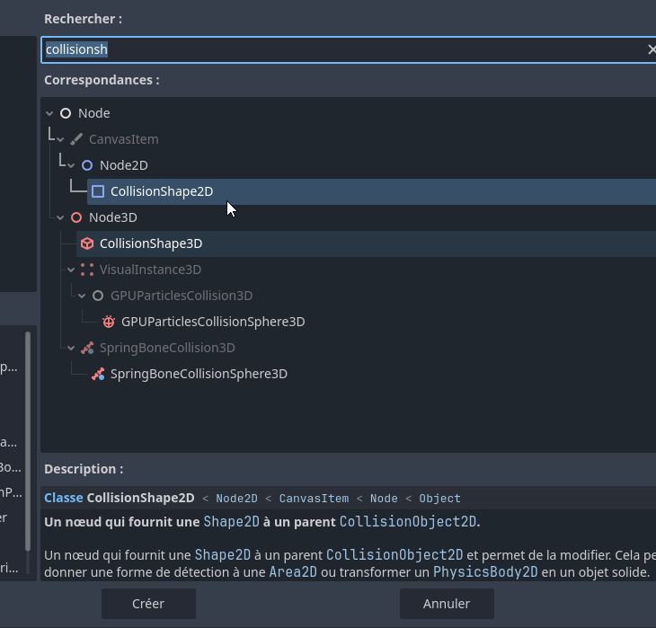

4. Renomme le `Label` pour `Pointage`.
    - Avec un « P » majuscule et sans faute! Le code du gestionnaire de jeu cherche un nœud avec exactement ce nom.

    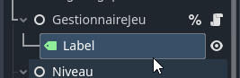

5. Dans l'**Inspecteur**, tu devrais voir une zone marquée `Text`. Écris « Bonjour » dedans.
6. Trouve le point (0, 0). Tu devrais voir « Bonjour ».
7. Déplace-le au-dessus du logo.
8. **Teste le jeu.** Ramasse une pièce et regarde le texte changer.

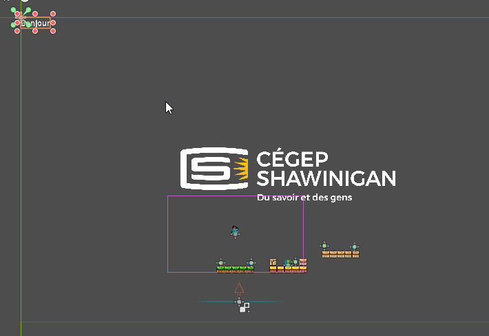

??? note "Comment ça fonctionne?"
    Le script `gestionnaire_jeu.gd` contient une fonction appelée chaque fois qu'une pièce est ramassée. Elle augmente le pointage et change le texte du `Label`.

    ```gdscript
    func ajouter_point():
    	score += 1
    	print (score)
    	if pointage != null:
    		pointage.text = "Tu as récolté " + str(score) + " pièces."
    ```

---

## Sauvegarder pour plus tard

Avec Godot Web, ton projet reste dans le navigateur. Si tu veux le garder :

1. Va dans le menu **Projet**.
2. Sélectionne **Outils**, puis **Download project source**.
3. Le fichier sera sauvegardé dans ton dossier **Téléchargements**.
    - Tu pourras le mettre sur une clé USB.
4. Pour rouvrir le projet, refais les étapes 2 et 3 du début avec ce fichier.

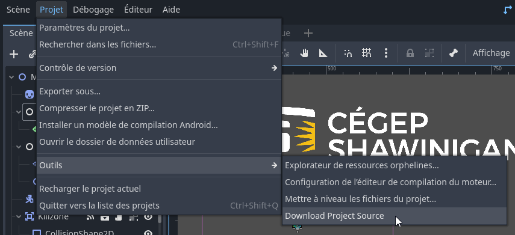

---

## Selon le temps restant

- **S'il reste moins de 20 minutes :**
    - Trace un niveau plus complet pour te rendre jusqu'au pointage.
    - Ajoute des ennemis, des pièces, des arbres.
    - Rends le jeu plus complexe!
- **S'il reste plus de 20 minutes :** fais l'extra ci-dessous.

---

## Extra : Plateforme mobile

J'ai fait des plateformes qu'on peut déplacer. Il va falloir bien suivre, car c'est une étape un peu plus compliquée.

### Ajouter la plateforme

1. Sélectionne le nœud `Niveau`.
2. Glisse le fichier `plateforme.tscn` sur `Niveau`.
    - La plateforme sera à (0, 0).
3. Déplace la plateforme près du jeu.

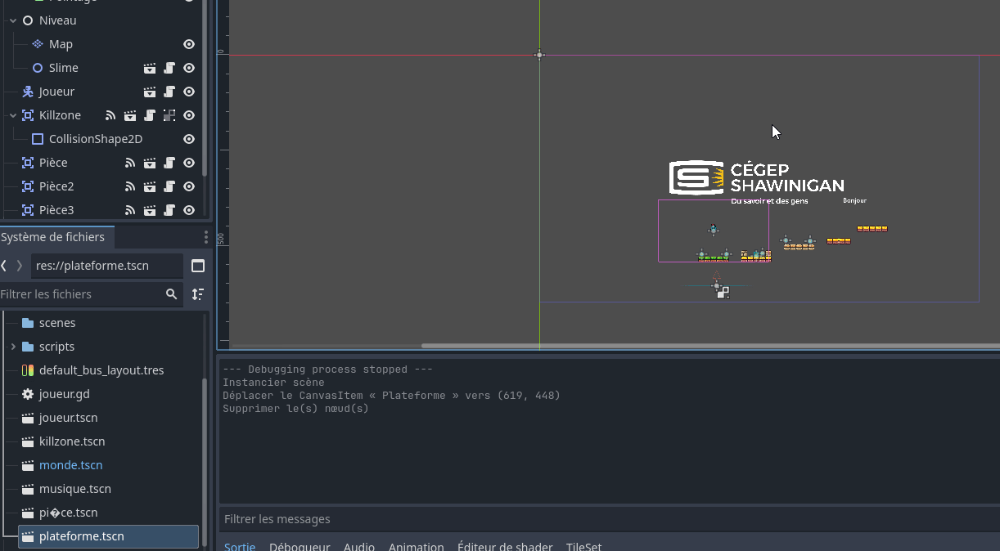

### Créer l'animation

1. Clique-droit sur le nœud `Plateforme` et ajoute un enfant de type `AnimationPlayer`.
    - Ce nœud permet d'animer des objets.
2. Dans le volet inférieur, il y a une section **Animation**.
3. Clique sur le bouton **Animation** et sélectionne **Nouveau**.
4. Donne le nom `bouge`.

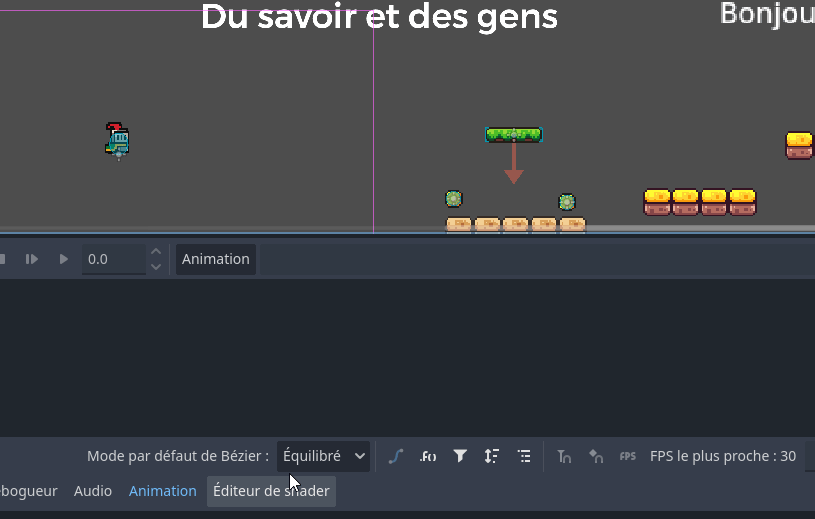

### Le point de départ

1. Sélectionne le nœud `Plateforme`.
2. Dans l'**Inspecteur**, recherche et clique sur `Transform`.
3. Tu devrais voir `Position` avec `x` et `y`.
4. Positionne la plateforme à son point de départ.

    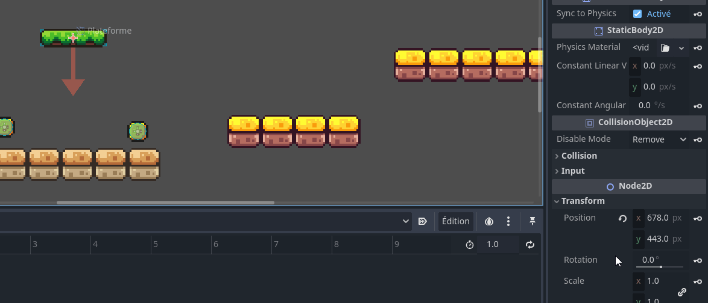

5. Repère la petite clé à côté de `Position` et clique dessus.
6. Un message apparaît. Clique sur **Créer**.
    - Ça crée ce qu'on appelle une **clé** dans la ligne de temps. L'animation va démarrer à la position où était la plateforme lorsque tu as cliqué sur la clé.

    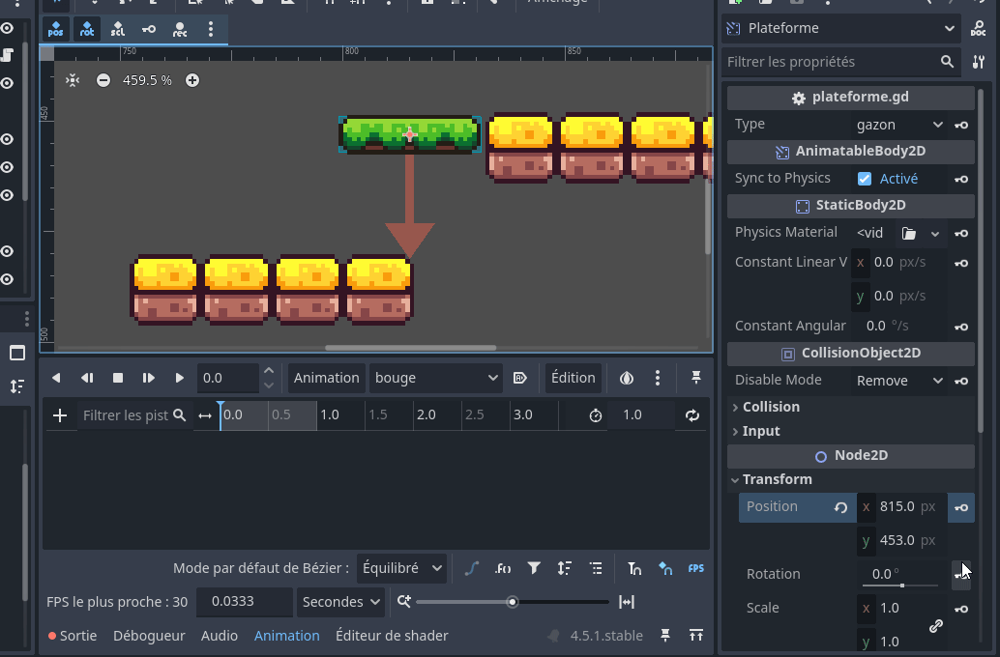

### Le point d'arrivée

1. Dans la ligne de temps, repère la ligne bleue verticale. Elle indique où en est l'animation.
2. Déplace-la à **1 seconde**.

    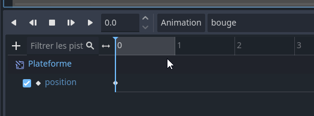

3. En t'assurant que la ligne bleue est à la bonne place, déplace la plateforme à sa destination.
    - Astuce : maintiens la touche `Majuscule` enfoncée pour déplacer en ligne droite.
4. Clique de nouveau sur la clé à côté de `Position`.

    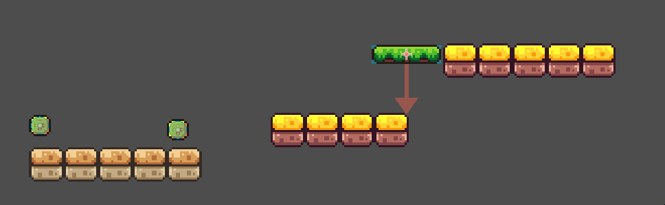

5. Tu devrais maintenant voir 2 petits losanges dans la ligne de temps.

    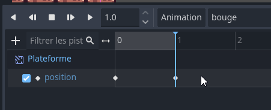

### Les options de l'animation

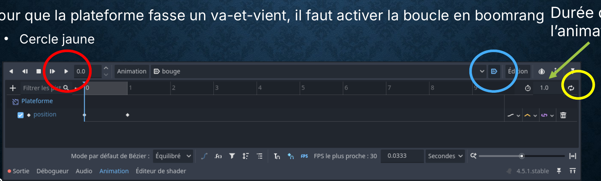

- **Cercle rouge** : le bouton *Play* au-dessus de la ligne de temps permet d'avoir un aperçu de l'animation.
- **Cercle bleu** : le bouton **Lecture automatique** permet de démarrer l'animation automatiquement lorsque le jeu commence. Active-le!
- **Cercle jaune** : la boucle en **boomerang** permet à la plateforme de faire un va-et-vient. Active-la aussi!
- La valeur à côté du chronomètre est la **durée de l'animation**.

**Teste le jeu!**

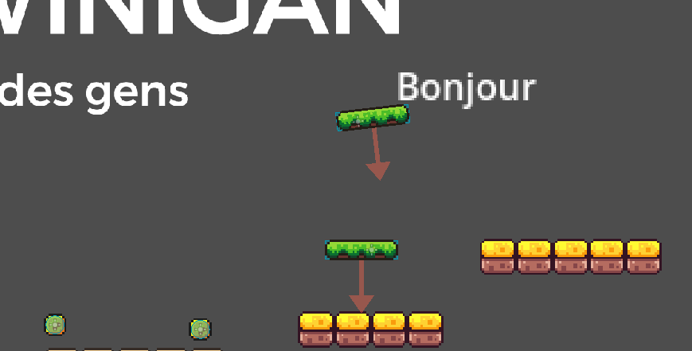

Pour ajouter d'autres plateformes, il faut répéter les étapes précédentes. Explore aussi la rotation et la mise à l'échelle (`Scale`)!

---

## Le temps restant

Maintenant, tu as tous les éléments pour faire un jeu de base. Améliore ton niveau en ajoutant des plateformes, des pièces, des ennemis, etc.

**Amuse-toi!**

<video controls src="assets/300_demo_finale.mp4" title="Démonstration finale" autoplay muted loop></video>

---

## Références

- [How to make a Video Game - Godot Beginner Tutorial (Brackeys)](https://www.youtube.com/watch?v=LOhfqjmasi0){target=_blank}
- [KidsCanCode](https://kidscancode.org/){target=_blank}
- [Ma chaîne YouTube](https://www.youtube.com/@NicolasBourre){target=_blank}
- [Godot Engine](https://godotengine.org/){target=_blank}
