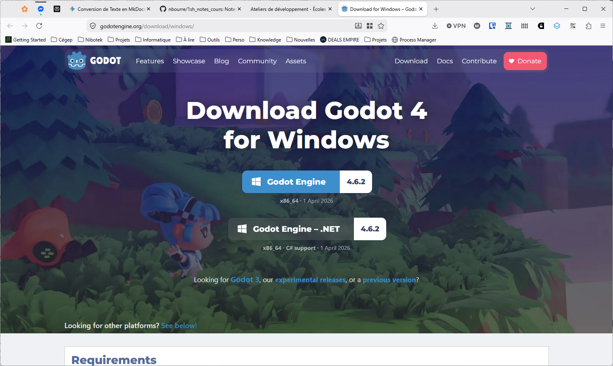
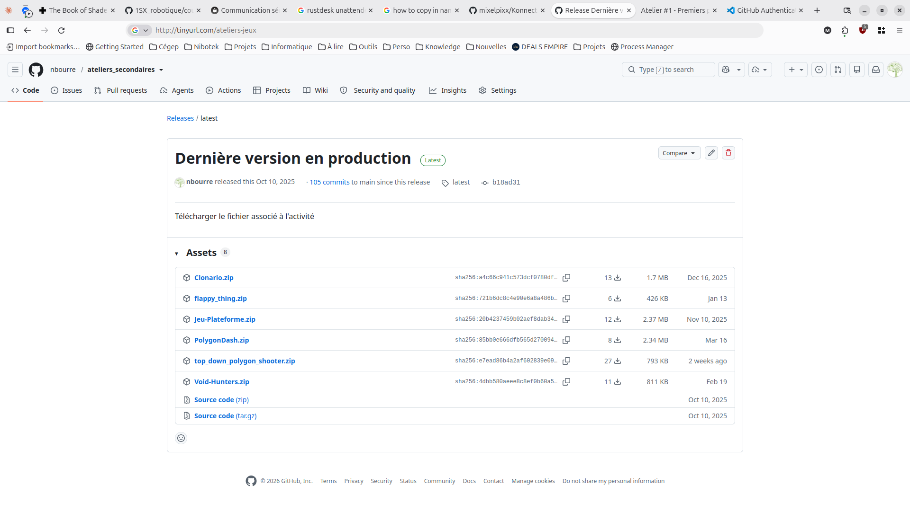
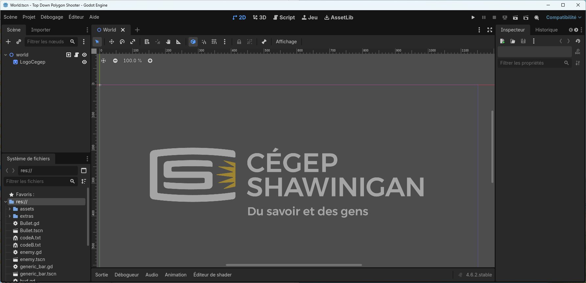
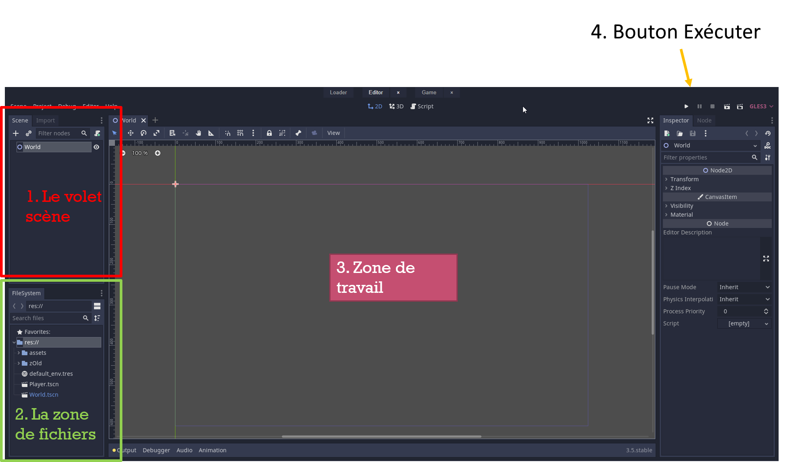
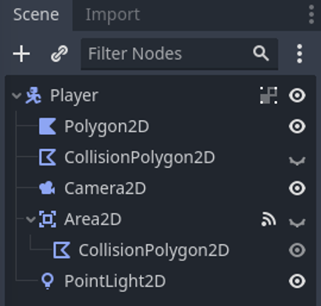
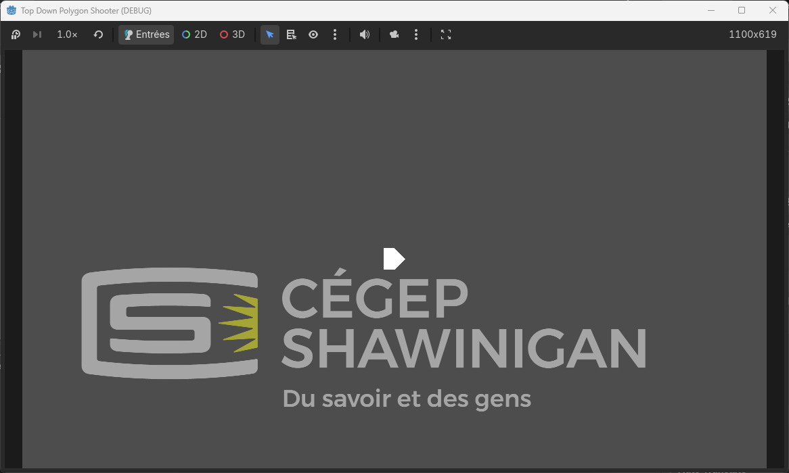

# Atelier Orientant : Jeux Vidéo
*Atelier sur la programmation d'un jeu vidéo — Cégep de Shawinigan*

!!! note "Système d'exploitation"
    Cet atelier est présenté sous Windows. Sur macOS et Linux, les étapes sont semblables, mais certains noms de boutons et raccourcis peuvent différer. L'application sur le Chromebook est possible, mais certains éléments du début dont la gestion des fichiers et l'installation de Godot sont différents. Au lieu d'utiliser une version installable, il est possible d'utiliser la version web de Godot (https://editor.godotengine.org/releases/latest/) pour éviter l'installation. Cependant, certaines fonctionnalités peuvent différer.

---

## Faire un Jeu Vidéo

### Qu'est-ce qu'il faut ?
* Vouloir apprendre
* Être autodidacte
* Modérer ses attentes

---

## Top-Down Shooter avec Godot

### Objectif de l'atelier
Créer le début d'un petit jeu de type **Top-Down Shooter**. Étant donné le temps limité, certains éléments sont fournis et préparés d'avance.

Nous allons utiliser le moteur **Godot Engine**, car il est gratuit, open-source, et relativement facile à apprendre pour les débutants.

### Étape 1 - Installation et exécution de Godot
1. Télécharge Godot Engine à partir de son site officiel : https://godotengine.org/download
2. Clique sur le bouton inscrit "Godot Engine" pour télécharger la version stable la plus récente.
    
3. Une fois le téléchargement terminé, ouvre l'Explorateur de fichiers en appuyant sur `Windows + E`.
4. Dans le volet de gauche, clique sur **Téléchargements**.
5. Repère le fichier téléchargé, qui devrait s'appeler quelque chose comme `Godot_vX.X.X-stable_win64.exe.zip`.
6. Sélectionne le fichier, clique sur **Extraire tout**, puis suis les instructions pour extraire son contenu.
7. Ouvre le dossier extrait et double-clique sur le fichier `Godot_vX.X.X-stable_win64.exe` pour lancer Godot.

### Étape 2 - Télécharger les ressources

1. Va à l'adresse suivante pour télécharger le projet de départ : `http://tinyurl.com/ateliers-jeux`
2. Dans la page qui s'ouvre, trouve le lien `top_down_polygon_shooter.zip` et clique dessus pour télécharger le fichier.



3. Un fichier nommé `top_down_polygon_shooter.zip` sera téléchargé dans ton dossier *Téléchargements*.

### Étape 3 - Repérer les ressources téléchargées

1. Répète les deux premières actions de l'étape 1 : ouvre l'Explorateur de fichiers avec `Windows + E`, puis clique sur **Téléchargements**.
2. **Sans cliquer**, repère le fichier `top_down_polygon_shooter.zip` que tu viens de télécharger.


### Étape 4 - Ouvrir Godot

1. Si tu as bien suivi l'étape d'exécution de Godot, tu devrais voir une fenêtre d'accueil avec plusieurs options.
2. Glisse et dépose le fichier `top_down_polygon_shooter.zip` que tu as téléchargé dans la fenêtre de Godot.
3. Clique sur "Installer" pour charger le projet.
4. Il se peut que tu aies une fenêtre d'avertissement de conversion du projet. Appuie sur "Ok" pour continuer.
    <video controls src="assets/install_project.mp4" title="Installer le projet" autoplay muted></video>
5. La fenêtre de Godot devrait maintenant afficher le projet `top_down_polygon_shooter`.



### Étape 5 - Découverte de l'environnement
L'environnement de travail des développeurs varie selon leur emploi (éditeur de texte simple, gestionnaires de réseaux complexes, outils spécialisés). Godot est un environnement propre au développement de jeux.



Dans la capture d'écran ci-dessus, on peut voir :

1. Le volet scène (à gauche) : Affiche la hiérarchie des éléments de la scène active.
2. Le système de fichiers (en bas à gauche) : Affiche les ressources du projet (images, sons, scripts, etc.).
3. La zone de travail (au centre) : C'est là que tu construis ta scène, en assemblant les éléments graphiques, les personnages, les ennemis, etc.
4. Les boutons de contrôle (en haut à droite) : Permettent de lancer le jeu, de faire des tests, etc.
    - Ce que l'on utilisera principalement est le bouton **Play** (triangle) pour tester le jeu.

#### La zone de travail
- Étant donné que l’on part avec un projet déjà débuté, la première chose à faire est d’examiner les ressources déjà présentes dans le projet.
- **Les ressources** peuvent être des images, des sons ou des éléments du jeu comme un personnage
- On remarque que la zone de travail a un onglet nommé `World`
- Il s’agit de la scène **World**

### Étape 6 - Exploration du projet
* **Le volet Scène (à gauche) :** Affiche la scène active.
  * Une scène est comme une pièce de théâtre (assemblage du personnage, décor, ennemis, PNJ, etc.).
* **Les ressources :** Images, sons ou éléments de jeu (comme un personnage).
* **Zone de travail :** Un onglet nommé `World` représente la scène principale.
* **Système de fichiers (en bas à gauche) :** On y voit `res://` et le dossier `assets`.

<video controls src="assets/systeme_de_fichiers.mp4" title="Système de fichiers" autoplay></video>

#### Explorer les ressources
* Dans les fichiers, tu peux voir le fichier `World.tscn` qui correspond à la scène `World` que tu vois dans la zone de travail.
* Pour l'instant il n'y a pas grand-chose dans la scène `World`, mais on va le remplir au fur et à mesure.
* Recherche le fichier `Player.tscn` dans le système de fichiers et double-clique dessus pour ouvrir la scène du joueur dans un nouvel onglet.
* Maintenant tu devrais voir la scène du joueur dans la zone de travail, avec les différentes ressources qui la composent (polygone, collision, caméra, etc.).
* Tu remarques aussi que l'onglet `World` est toujours ouvert. Tu peux basculer entre les deux scènes en cliquant sur les onglets correspondants.

<video controls src="assets/onglet_player_world.mp4" title="Title" autoplay></video>

### Étape 7 - Configuration du Joueur (Player)



La scène du joueur est composée de **Nœuds** (éléments de base dans Godot) :

* **Player (Nœud parent) :** De type `CharacterBody2D` pour gérer la physique du personnage.
* **Polygon2D :** Le polygone représentant graphiquement le personnage.
* **CollisionPolygon2D :** Zone de collision (rectangle turquoise).
* **Area2D :** Gère les collisions avec d'autres éléments.
* **Camera2D :** La caméra qui suit le personnage (rectangle rose).
* **PointLight2D :** Effet lumineux qui suit le personnage.

*Note de navigation : Utilise la molette de la souris (ou deux doigts sur le trackpad) pour zoomer et te déplacer dans la zone de travail.*

!!! Warning "J'ai déplacé le personnage !"
    Si tu as accidentellement déplacé le personnage dans la scène `Player`, tu peux réinitialiser sa position en sélectionnant le nœud `Player` et en appuyant sur la combinaison de touches `Ctrl + z` pour annuler le déplacement.

    Sinon, tu peux aller dans le volet "Inspecteur" (à droite) et rechercher pour la propriété "Transform" -> "Position". Clique sur la petite flèche circulaire à côté de "Position" pour réinitialiser les coordonnées du personnage à (0, 0).

    <video controls src="assets/reset_joueur.mp4" title="Title" autoplay></video>

### Étape 8 - Placer le joueur dans le monde

1. Tu peux fermer l'onglet `Player` en cliquant sur la croix à côté de son nom.
    - Si tu as fait des modifications dans la scène `Player`, Godot te demandera si tu veux les enregistrer. Clique sur `Ne pas enregistrer` pour ne pas enregistrer les modifications.
2. Sélectionne la scène `World`.
3. Glisse et dépose le fichier `Player.tscn` sur le logo dans la zone de travail de la scène `World` (ou sur le nœud `world` dans le volet Scène).
4. Repositionne le personnage pour qu'il soit bien placé afin de voir le logo.
    - Le logo nous sert de point de repère pour savoir où se trouve le personnage dans la scène.
    <video controls src="assets/add_player.mp4" title="Ajout du joueur" autoplay muted></video>
5. Clique sur le bouton **Play** (en haut à droite) pour tester.

    
6. Appuie sur le `X` pour fermer la fenêtre de test du jeu.

### Étape 9 - Programmation du Joueur

1. Ouvre l'onglet `Player`
2. Sélectionne le nœud `Player` dans le volet scène (Rappel : utilise le volet Scène pour naviguer entre les nœuds).
3. Clique-droit sur le nœud `Player` -> Sélectionne **Attacher un script...**.
4. Dans la fenêtre, clique sur **Créer**.

<video controls src="assets/player_attach_script.mp4" title="Title" autoplay></video>

1. Godot va automatiquement créer un fichier de script nommé `Player.gd` et l'ouvrir dans l'éditeur de code intégré.
2. Il y aura du code de base généré automatiquement.
3. Teste le jeu pour voir ce que fait le code de base.

??? note "Que fait le code de base?"
    Étant donné que le joueur est de type `CharacterBody2D`, le code de base inclut le code pour gérer les mouvements de base du personnage (gravité, déplacement, etc.) pour un modèle de jeu de plateforme (side-scroller). Cependant, comme nous faisons un jeu top-down, ce code ne correspond pas à nos besoins. Nous allons donc le remplacer par du code adapté à un jeu top-down.

#### Remplacer le code de base

1. Efface tout le code de base généré par Godot. Clique n'importe où dans le code, sélectionne tout (`Ctrl + A`) et appuie sur la touche `Suppr`.
2. Dans le système de fichiers (volet en bas à gauche), tu devrais retrouver `codeA.txt`.
3. Double-clique dessus pour l'ouvrir.
4. Sélectionne tout le code dans `codeA.txt` (`Ctrl + A`) et copie-le (`Ctrl + C`).
5. Dans l'éditeur de code, tu devrais voir le fichier `Player.gd` dans les fichiers ouverts. Sélectionne-le.
6. Ensuite, colle le contenu copié (`Ctrl + V`).
7. Teste le jeu : tu peux maintenant déplacer le personnage avec les touches **WASD**.

<video controls src="assets/player_codeA_test.mp4" title="Test du codeA" autoplay></video>

#### Orienter le personnage avec la souris
Dans le code, regarde vers la ligne 22, tu devrais voir une ligne qui ressemble à ceci :

```gdscript
	#look_at(get_global_mouse_position())
```

Il s'agit d'une ligne de code commentée (le `#` au début indique que c'est un commentaire, donc cette ligne n'est pas exécutée). Cette ligne est censée faire en sorte que le personnage regarde vers la position de la souris.

Retire le `#` au début de la ligne pour décommenter le code, puis teste le jeu. Tu devrais voir que le personnage s'oriente maintenant vers la position de la souris.

!!! Warning "Il y a une ligne rouge"
    Si tu vois une ligne rouge après avoir supprimé le `#`, cela signifie que tu as peut-être accidentellement supprimé la tabulation qui se retrouve au début de la ligne. Assure-toi que la ligne `look_at(get_global_mouse_position())` est bien alignée avec les autres lignes de code (c'est-à-dire qu'elle doit commencer à la même position que les autres lignes, sans espace ou tabulation supplémentaire au début).

<video controls src="assets/player_test_look_at.mp4" title="Title" autoplay></video>

#### Ajouter le système de tir

1. Va à la fin du code actuel et appuie sur `Entrée` pour créer une nouvelle ligne.
2. Supprime les espaces ou tabulations au début de cette nouvelle ligne pour que le curseur soit aligné tout à gauche.
3. Ouvre le fichier `codeB.txt` et copie tout son contenu.
4. Reviens sur le fichier `Player.gd` et colle le code copié à la fin du fichier.
5. Regarde vers la ligne 24, tu devrais voir une ligne qui ressemble à ceci :
    ```gdscript
    #if (Input.is_action_just_pressed("fire")):
        #fire()
    ```
6. Retire les `#` au début de ces deux lignes pour décommenter le code.
7. Teste le jeu et appuie sur le bouton de la souris pour tirer un projectile.
    <video controls src="assets/player_test_fire.mp4" title="Title"></video>
8. Tu peux maintenant revenir en mode "2D"
    - Clique sur le bouton "2D" au centre de la fenêtre de Godot pour basculer en mode d'édition 2D.
9. Ferme l'onglet `Player` pour revenir à la scène `World`. 

### Étape 10 - Ajout des Murs (Décors)

1. Glisse et dépose le fichier `Level.tscn` dans la zone de travail en prenant soin de faire en sorte que le joueur ne soit pas sur un mur.
2. Teste le jeu.

<video controls src="assets/level_test.mp4" title="Title" autoplay loop></video>

### Étape 11 - Ajout des Ennemis

1. Reviens à la scène `World`.
2. Recherche le fichier `Enemy.tscn` dans le système de fichiers.
3. Glisse le fichier `Enemy.tscn` dans la zone de travail pour l'ajouter à la scène `World`.
4. Teste le projet pour voir l'ennemi apparaître.

### Étape 12 - Dupliquer les Ennemis

1. Ajoute plusieurs ennemis dans le jeu
2. Tu peux dupliquer un ennemi déjà placé en le sélectionnant dans la scène `World`, puis en appuyant sur `Ctrl + D` pour créer une copie de cet ennemi. Positionne les ennemis dupliqués à différents endroits de la scène.
    <video controls src="assets/ennemi_duplicate.mp4" title="Title" autoplay></video>
3. Teste le jeu pour voir tous les ennemis que tu as ajoutés.

---

## Fonctionnalités Extra (Bonus)

### Système de Pointage

1. Ouvre la scène `World`.
2. Dans le Système de fichiers, recherche `hud.tscn`.
3. Glisse-le sur la zone de travail n'importe où dans la scène `World` pour l'ajouter.
4. Teste le jeu pour voir le score s'afficher.

### Génération automatique (Spawning)

1. Dans le volet Scène, sélectionne le nœud `world`.
2. Dans la scène `World`, fais un clic-droit sur le nœud `world`.
3. Clique sur **Ajouter un nœud enfant…**
4. Recherche et sélectionne **Timer**.
5. Renomme le nœud exactement `MobTimer` (attention aux majuscules!).
6. Teste la génération automatique des ennemis.

<video controls src="assets/MobTimer.mp4" title="Title"></video>

### Modification des Murs et du Code

* **Éditer la carte :**
    * Double-clique sur `Level.tscn`.
    * Sélectionne le nœud `Tilemap`.
    * Dans le panneau du bas, sélectionne l'icône du crayon.
    * Clique sur le carré jaune pour dessiner des murs (clic gauche pour ajouter, clic droit pour retirer).
* **Ajuster les variables :**
    * Double-clic sur le fichier `Player.gd` pour ouvrir le code du joueur.
    * Modifie les variables `speed` ou `bullet_speed` pour ajuster la vitesse du joueur ou des projectiles.

---

## Résumé et Conclusion

* Un simple jeu 2D peut prendre plusieurs jours, voire des mois à compléter.
* Derrière chaque jeu, il y a une équipe de spécialistes :
    * Programmation
    * Level Designer
    * Programmation de la physique et du moteur, etc.
* Ce sont pour la plupart des personnes qui ont une formation en informatique.

### Références

* [Vidéo complète pour faire le jeu de A à Z](https://youtu.be/v7gknRcUwTs?si=rXVioMCWfvUK0oyi)
* [Kid's can code](https://kidscancode.org/godot_recipes/4.x/)
* [Moteur de jeu Godot Engine](https://godotengine.org/fr/)
